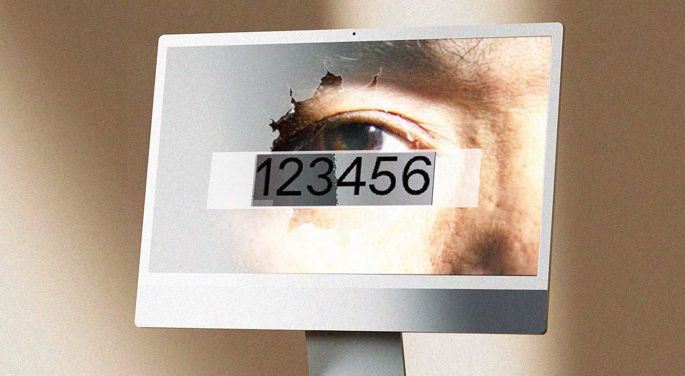
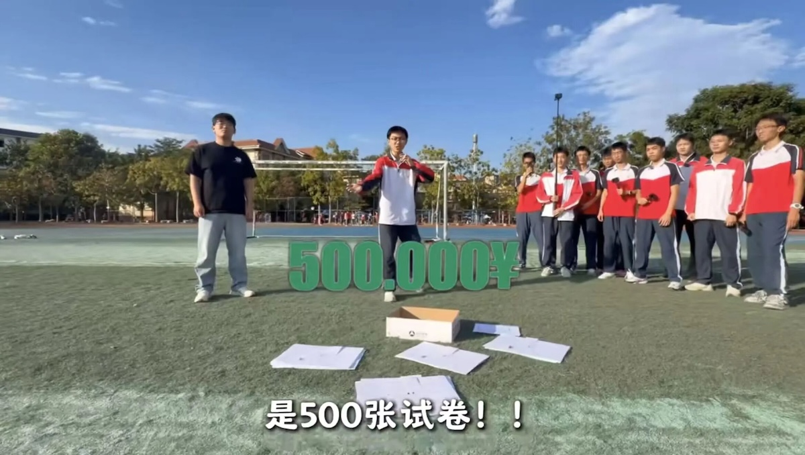
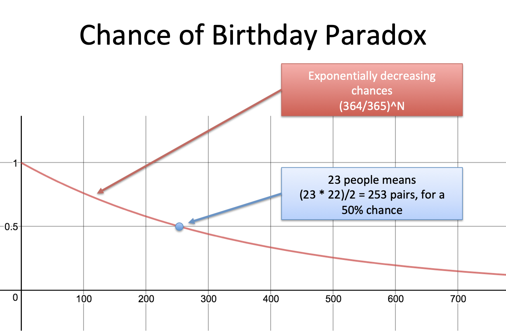
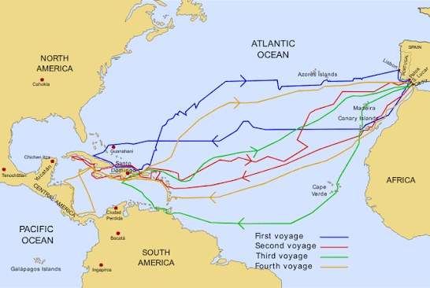
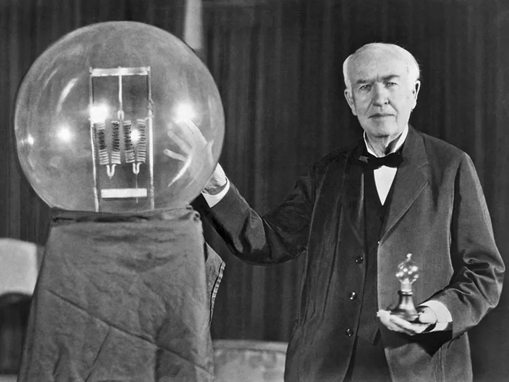
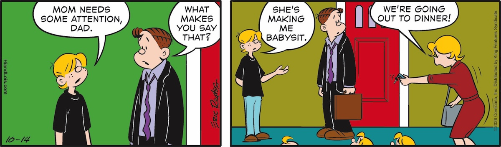

## Editor's Words

Recently, the subscribers to the podcast of The Sunday Blender (“TSB") have outpaced the growth of the email newsletter. It seems that a lot more users are increasingly turning to audio/video platforms as the go-to destination for information/content discovery.

So I’ve created a video podcast for TSB on Youtube ([https://www.youtube.com/playlist?list=PLcRJg9AlaYT4](https://www.youtube.com/playlist?list=PLcRJg9AlaYT4)) and the audio version on both Apple Podcast ([https://podcasts.apple.com/us/podcast/the-sunday-blender-podcast/id1853996806](https://podcasts.apple.com/us/podcast/the-sunday-blender-podcast/id1853996806)) and Spotify ([https://open.spotify.com/show/0p6Boxgcyy9eJzdBQlu4CG](https://open.spotify.com/show/0p6Boxgcyy9eJzdBQlu4CG)). 

If you’re in China, you can also just go with Xiaoyuzhou ([https://www.xiaoyuzhoufm.com/podcast/691d248b88967822c085fda5](https://www.xiaoyuzhoufm.com/podcast/691d248b88967822c085fda5)), the Spotify of China.

Let me know how you like the two co-hosts of the podcast show. They can get chatty sometimes.

Now, enjoy your commute to work/school and the long road trips during holidays, with the best weekly news, The Sunday Blender (erh, did I just skip the “kids” caveat?).

## Tech

**Tesla** has shown off a sports car that can leave the ground. At a **SpaceX** test site in Texas on October 15, a new Tesla **Roadster** with no one inside drove up a curved ramp, rode along it upside down, launched into the air, rolled over, and landed on its wheels. In another stunt, it flipped over a row of parked Tesla vehicles, including a tall Semi truck. Fans under the car suck air out from beneath it, pressing it toward the surface, which kept it stuck to the ramp even upside down. To fly, it carries tanks of air squeezed to high pressure and blasts it out through `10` nozzles built with help from SpaceX, **Elon Musk**’s rocket company. Tesla says the thrusters push four to five times harder than the tires can grip, helping the car reach `60` miles per hour (about 97 km/h) in under a second.

Humanoid robots on wheels, with a human-like body, arms and head on a rolling base, did factory jobs at the **China International Industry Fair** in Shanghai, one of China's biggest factory-technology shows, held October 12 to 16. The robot maker **JAKA** debuted a wheeled humanoid that moved boxes around a corner of the hall on its own. **AGIBOT**'s G2 robots plugged in parts and stacked boxes, and staff said the same model already works on a tablet production line in the city of **Nanchang**. Inovance showed its first humanoid robot, which loaded parts for a welding robot. Most factories have flat floors, so wheels are enough. A wheeled robot stays steadier, costs less to build, and has room in its base for a bigger battery, according to AGIBOT executive Yao Maoqing. A robot on two legs, he said, keeps using power just to stay balanced, even when standing still.

Nearly `90,000` songs made entirely by artificial intelligence (AI) are uploaded to the French music app **Deezer** every day, more than half of the new songs on its busiest days. This week, two music services announced ways to spot or skip them. On October 14, **YouTube Music** began putting a “`Made with AI`" label on songs created mainly by AI, such as tracks where a computer program made the tune and the singing. YouTube decides using what uploaders tell it and its own detection tools, so some AI songs may still play without a label. Deezer will add a switch before the end of 2026 that hides fully AI songs from search results. In July 2025, an AI "band" called the **Velvet Sundown** had more than `1 million` monthly listeners on Spotify. In a 2025 Deezer survey of 9,000 people, `97%` failed to spot the AI songs in a listening test.

**Anthropic**, the company that makes the AI assistant **Claude**, has moved its main code off **Git**, the most popular tool programmers use to save every version of their code so they can track changes and work together. On October 13, it said the code now lives in **Scion**, a system it built itself. Claude writes so much code that the number of changes Anthropic added each day jumped from about `2,500` in May to more than `30,000` in September. Git gives every computer a full copy of all the code, and Anthropic's copy had grown too big to send out millions of times a day. Scion keeps the code on central computers and sends only the files each job needs. A team of seven built it in five months with Claude's help. Anthropic says Scion only makes sense for enormous projects and has no plans to release it.

## Global

**Singapore** has had unhealthy air every day since October 5, its longest such stretch since 2015. On October 16, the city’s Pollutant Standards Index, a measure of air pollution, hit `229` in the central region, the highest reading this year and in the “very unhealthy” range. On October 12, **IQAir**, a Swiss air-quality company, ranked Singapore the most polluted city in the world. The smoke comes from fires in **Indonesia**, on Sumatra and on its part of the island of Borneo. This year’s fires are stronger than usual because **El Niño**, a natural weather pattern, has brought drought to Indonesia. Many fires burn in peatland, soil packed with old plant matter that can smolder underground and flare up again after the flames seem gone. The haze has spread across the region, closing schools for about `2 million` students in **Malaysia**, shutting schools across East Timor and drifting as far as the **Philippines**.

Hackers took control of the refrigerators in hundreds of supermarkets across **France**, up to `700` by some counts, on the night of October 11, while the stores were closed. Supermarket fridges and freezers are run by control panels that can be reached over the internet, so technicians can check temperatures remotely. The attackers got in through that connection. Freezers normally run a short defrost cycle at night, warming up slightly to melt built-up ice. The hackers forced the defrost to keep running and set temperatures to `50°C`, even higher in some stores. By morning, shops had to throw away spoiled food. Many of the targeted controllers, mostly made by Danish company **Danfoss**, were old models no longer getting security updates, or had never been updated. After the attack, Reuters found at least `4,500` Danfoss control panels visible online. No one has claimed the attack, and no ransom has been demanded.

In September, the names, addresses and ID numbers of about `8.8 million` people were taken from **Denmark**’s national population register. The government disclosed the breach on October 5. Denmark has only about `6 million` people. The number is bigger because the register also keeps records of people who have died or moved abroad. At least three accounts at a small company allowed to search the register, including an administrator account, used the password `123456`, according to the Danish newspaper **Politiken**. An anonymous person claiming to be the hacker told Politiken that is how they got in. Officials have not confirmed it. 123456 is often ranked the world’s most common password, and among the weakest.

More than `45,000` people applied to compete in a sleeping race in **Tokyo** on October 5, and about `65` were picked. The contest, called “Matt Race” and run by the mattress company Koala, offered a top prize of more than `$14,000`. The exact amount, `2.22 million` yen, was chosen because 222 looks like “`Zzz`.” Racers in pajamas slept in groups of about 20 for up to 90 minutes, with sensors on their foreheads and behind their ears measuring their brain waves. A score based on how fast they fell asleep, how deeply they slept, and how steady their sleep was decided the winner. Three times during each race, organizers tried to disturb them with a doorbell, the sounds of a delivery driver and a flashing disco ball. Some woke up; others slept straight through. The winner, a 24-year-old woman competing as “Suimii,” said she had once fallen asleep at a loud concert. She plans to use the prize money to move into her own place.

An 18-year-old high school senior in Jinghong, in **China**’s southwestern Yunnan province, has turned games of hide-and-seek between teachers and students at his school into a hit online variety show. **Chen Lewei** got his start at the end of junior high, when he asked for a camera as a graduation gift, and his parents bought it. The camera got him into photography, and he now plans, directs, and edits every episode himself and runs the account, with classmates and teachers as the cast. Because he is still in school, he films only during holidays, shooting on the first day and editing for the next two. For one episode, 14 players each filmed about an hour of footage, and Chen stayed up two nights cutting 14 hours down to 30 minutes. His first episode, posted on January 1, got `1 million` likes within five hours, and his account now has more than `1.2 million` followers.

## Nature & Environment

A black-and-white photograph of a female elephant carrying a dead calf in **Namibia** has won **Wildlife Photographer of the Year 2026**. Italian photographer Federico Veronesi called it “**The Aftermath**.” Elephants in both Africa and Asia have been seen guarding the bodies of the dead and carrying them, said the **Natural History Museum** in London, which runs the contest. This year’s contest drew a record `65,403` entries from `121` countries and territories. The top prize for young photographers went to Oscar Whitfield, a British photographer living in **Zimbabwe** who entered the 11-to-14 age group, for an eye-level shot of a dung beetle pushing its ball of dung through the sand. His picture is black and white too, the first time in the contest’s 62-year history that both top prizes have gone to black-and-white photographs. The winning photos are on show at the museum until July 2027.

## Science

**NASA**’s **Perseverance** rover has driven farther than any other vehicle on a world other than Earth. On October 11, its odometer reached `45.22 km`, edging past the 45.16 km set by NASA’s **Opportunity** rover, which explored **Mars** from 2004 to 2018. Opportunity needed nearly 15 years to cover that distance; Perseverance did it in about five and a half. Much of the credit goes to its self-driving system, **AutoNav**. As it rolls, Perseverance photographs the ground ahead, builds a 3D map of hazards, and picks the safest route between stops chosen by planners on Earth. Perseverance has driven more than 90% of its total distance this way, compared with about 5% for Opportunity. Its mission was originally planned for just `20 km` of driving. The rover is now exploring what may be some of the oldest rock ever studied in the solar system, and NASA has extended its mission to about the end of 2028.

## Math

In a group of just `23` people, there is a better-than-even chance that two of them share a birthday. The exact odds are about `51%`, even though a year has `365` days. This surprise is called the **birthday paradox**, though it is not a real paradox, just a result that feels wrong. The key is counting pairs of people. With 23 people, there are `253` different pairs, and each pair is a fresh chance for a match. Mathematicians work it out backward: they calculate the odds that nobody shares a birthday, then subtract from 100%. With 30 people, the chance of a match rises to about `70%`. With 70 people, it reaches `99.9%`. Finding someone who shares your own birthday is much harder. For a 50% chance of that, you would need about `253` other people.

## Lifestyle, Entertainment & Culture

Canadian poet, essayist, and classicist **Anne Carso**n has won the 2026 **Nobel Prize** in Literature, considered the highest honor for a writer. Carson, 76, has spent her life studying, translating and teaching ancient Greek and Latin, and the **Swedish Academy** praised her for using those old stories to invent new kinds of writing. Her breakout book, **Autobiography of Red**, is a novel told in poems. It takes Geryon, a red, winged monster killed by the hero Herakles in a Greek myth, and turns him into a modern young man searching for who he is. When she translated **Sappho**, an ancient Greek poet whose poems survive only as broken fragments with many words lost, Carson used brackets to show readers exactly where the gaps fall. Another of her books, Nox, mixes poems with family photos, letters, drawings, and collage.

**Columbus Day** marks the day **Christopher Columbus**’s ships reached the Americas: **October 12, 1492**. Presidents have proclaimed Columbus Day since 1934, and it became a federal holiday, fixed to the second Monday of October, in 1971. Many states and cities mark **Indigenous Peoples’ Day** on the same Monday, honoring Native American peoples. Columbus set out from **Spain** with three ships and roughly 90 men, expecting to reach Asia by sailing west. He kept two records of how far the ships sailed each day. The figures he gave the crew showed shorter distances, so the men would not panic about how far from home they were. A later study by navigator J. W. McElroy found Columbus had been overestimating distances by about `9%`, so the figures he gave the crew were closer to the truth. By October 10, the crew was close to mutiny. Shortly after 2 a.m. on October 12, a lookout saw something white gleaming in the moonlight and shouted “Tierra!”, Spanish for “Land!” The Lucayan people living there called the island Guanahani; Columbus named it San Salvador. It lies in today’s **Bahamas**. He never reached Asia, but died in 1506 still believing the islands he had found were off the coast of Asia.

## Sports

**Lionel Messi** played his last match for **Argentina** on October 6, and **Buenos Aires** turned it into a celebration. Landmarks across the city glowed in the team’s sky blue and white, and Messi wiped away tears as thousands of fans lined the road to the **Monumental Stadium**. When the national anthem played, he and coach Lionel Scaloni both cried, with Messi’s three sons standing beside him. Ten minutes into the friendly against **Benin**, the referee stopped play so `85,000` fans could salute their `39`-year-old captain. Messi set up two goals, then smashed a penalty into the roof of the net to seal a `3-0` win. After the final whistle, drones lit up the sky with scenes from his career, including him holding the World Cup trophy in 2022. Then Messi took the microphone and called the farewell “the saddest day of my career.” The first person he thought of, he said, was his father, who died in August. Over `21` years, he scored `126` goals for Argentina, more than anyone else, and won the World Cup and two **Copa América** titles. “I leave grateful, proud and at peace,” he said.

**Kylian Mbappé**, **Erling Haaland**, **Harry Kane** and **Lamine Yamal** all reached milestones this week. On October 14, Mbappé, 27, became the youngest player to reach `100` **Champions League** games, scoring as **Real Madrid** beat **Roma** `4–3`. That same night, Haaland, 26, scored twice for **Manchester City** to reach `61` **Champions League** goals in `60` games, the fastest ever to 60. Three days later, he reached `100` Premier League goals not counting penalties, in `139` games, also the fastest ever. Kane, 33, played his 100th German league game for **Bayern Munich** on October 17 and scored in a `6–1` win, giving him `102` goals in those `100` games. Yamal, 19, scored and set up another goal as **Barcelona** won `5–2` at **Real Betis**, matching the best start in Spanish league history: nine wins in nine games.

Olympic champion **Zheng Qinwen** won the **China Open** in Beijing on October 11, becoming the first Chinese player to take the women’s title. She beat **Mirra Andreeva**, this year’s **French Open** champion, `7-5`, `6-4`. It was Zheng’s first title in two years and her first at the **WTA 1000** level, the tour’s biggest events after the four **Grand Slams**. After elbow surgery in July 2025, her ranking had dropped from a career-high No. 4 to `No. 54`, so she entered as a wildcard, an invitation from organizers. In the final, she saved three set points in a tight first set and won on her first match point with an ace before falling to the court in tears. At the trophy ceremony, she sang the theme song from “Shen Bing Kids,” a Chinese cartoon she loved as a child, then apologized to the crowd for singing off-key. During the family photo, she pulled off her father’s cap because it carried the French Open logo; he laughed and tucked it into the trophy.

More than `250` people, some from as far away as Japan, gathered in the English village of **Southwick** on October 11 for the **59th World Conker Championships**. Conkers is a traditional British and Irish game played with the seeds of horse chestnut trees. Players bore a hole through a hard conker, thread it onto a string, then take turns swinging it at their opponent’s dangling conker until one of them breaks. The championship started in the nearby village of Ashton, when some locals held a conker contest instead of going fishing. Plenty of players dress up: this year’s overall winner, 28-year-old Frankie Hooper, wore a tiger costume, and her friends came as animals from **Noah’s Ark**. Hooper and men’s champion Simon Griffiths were crowned Queen and King Conker and sat on golden thrones topped with conkers. The event raises money for charities helping people with poor eyesight.

## This Day in History

On **October 18, 1931**, **Thomas Edison**, widely regarded as one of the greatest inventors in history, died at his home in West Orange, New Jersey, at age 84. He received `1,093` US patents, the first in 1868 for an electric vote-counting machine that drew no interest. After that, he vowed never to invent anything again without first knowing people would buy it. His laboratory in **Menlo Park, New Jersey**, where a team of assistants worked with him, earned him the nickname “Wizard of Menlo Park.” There he and his team developed the phonograph, which could record and play back sound, and in 1879, a practical electric light bulb. Edison often improved other people’s inventions, making them practical enough for everyday use. He later helped develop early movie cameras and projectors. Three days after his death, **President Herbert Hoover** asked Americans to turn off their lights for one minute in his honor.

## Art of the Week

About 500 years ago, a painting of a Japanese shrine worked as a map, a comic strip, and an advertisement all at once. **The Kumano Nachi Pilgrimage Mandala** shows the Kumano Nachi Taisha shrine and its surroundings, with **Nachi Waterfall** and the sun on one side and a temple and the moon on the other. The same two pilgrims dressed in white appear again and again across the picture, so viewers could follow their journey scene by scene. One is a man and one a woman, a sign that Kumano welcomed both. Traveling nuns called Kumano bikuni carried copies across Japan, unrolled them in public places and explained the scenes to audiences, raising money for the shrines and drawing new pilgrims. **Nachi** is one of three grand shrines linked by the **Kumano Kodo**, a network of trails that is one of only two pilgrimage routes on **UNESCO**’s World Heritage list, alongside Spain’s **Camino de Santiago**. When the trail joined the list in 2004, the shrine town of **Hongu**, a key stop on the trail, hosted `492` overnight guests from abroad; in 2024, it hosted a record `44,540`.

## Funny

---

## Previous Issues

---

October 04, 2026, **[Flowers and Crayfish in the Desert](https://weekly.sundayblender.com/p/flowers-and-crayfish-in-the-desert/)**

September 27, 2026, **[We Will Go To the Moon Again](https://weekly.sundayblender.com/p/we-will-go-to-the-moon-again/)**

September 20, 2026, **[Tech Tourism in China Has Begun](https://weekly.sundayblender.com/p/tech-tourism-in-china-has-begun/)**

---

Thanks for reading! If you enjoy this newsletter, please share it with friends who might also find it interesting and refreshing, if not for themselves, at least for their kids.

