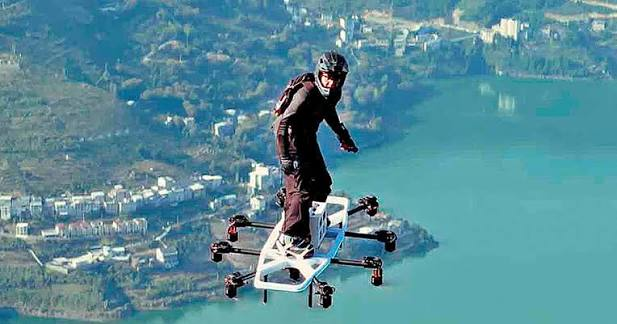
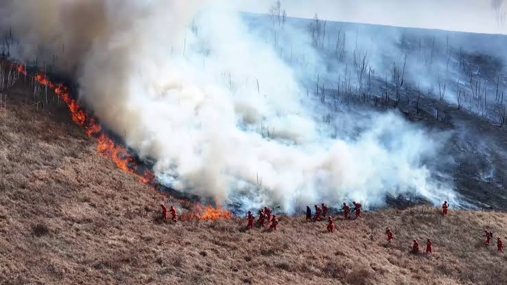
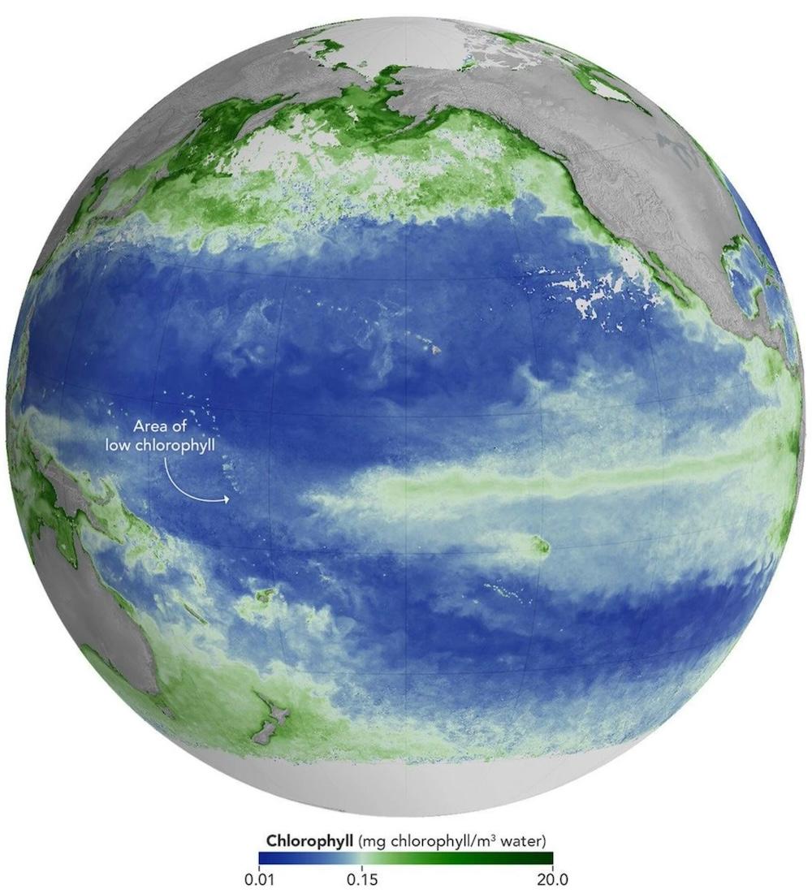
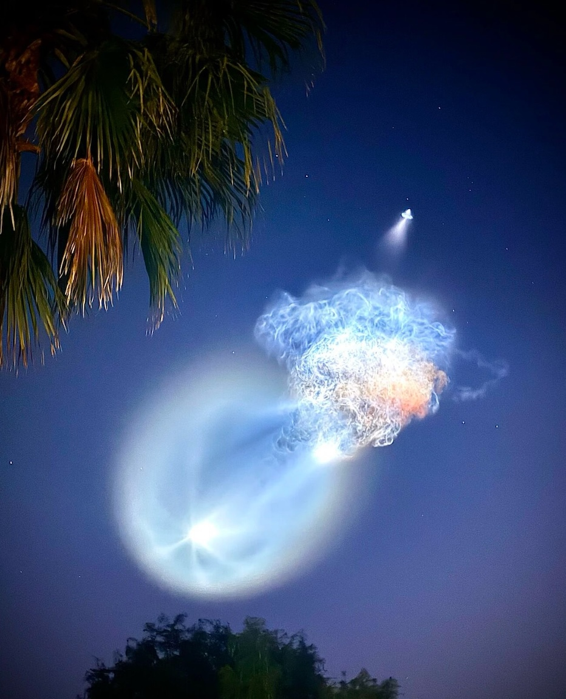
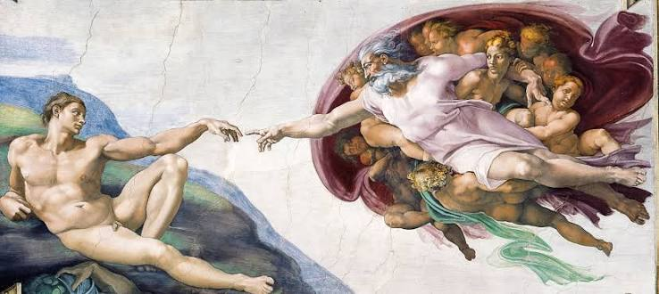
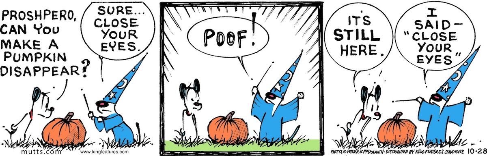

## Editor's Words

Howdy! I’m back from a cycling trip in Nanjing. Thanks for the wait. 

A shout-out to **Brandon**, who contributed a story in his own words for this Nov 1 issue of The Sunday Blender, and in the prestigious Math section no less. Attaboy!

Another shout-out to **Ashe**, my editor-in-chief bot from **Grok**, who picked the comedy strip for me. Picking a funny enough comedy strip is a fun part of this weekly task, but also a challenging one because I have to read through many columns from The New Yorker, Washington Post, New York Times, and USA Today. Ashe has proven it is capable of matching my taste, at least for one week, in this area. Way to go Grok!

## Tech

On October 26, **Microsoft** offered about `60,000` employees, roughly a quarter of its workforce, a “voluntary exit”: a chance to leave by the end of the year with a severance package, including pay based on how long they have worked there. Nobody is forced to go, and Microsoft says it expects only a small share to accept, but the offer comes as the company pours money into data centers for artificial intelligence. Employees who work on those data centers were not offered the deal. Carmakers in Europe are cutting jobs too. Germany’s **BMW**, which aims to cut about `8,000` jobs, began offering exit packages in October to nearly half its staff in Germany, and Sweden’s **Volvo** Cars announced `2,500` job cuts, about `6%` of its staff, after a quarterly loss. Both are dealing with falling sales in China and tough competition from Chinese carmakers. At both companies, the cuts fall mainly on office jobs rather than factory lines, and at BMW so many staff signed up that it reportedly reached its target early.

**Song Xingyu** left school at 14 to work at his father’s lumberyard in rural **Hubei**, **China**. Now 26, he has taught himself mechanics and flight control and become famous online for building flying machines. His latest is a real-life version of the **Green Goblin**’s glider from the **Spider-Man** movies. His first try used five small jet engines, but when he ran them together, hot exhaust bounced back into the engines, and they caught fire. He fed the test data to an AI assistant, which suggested switching to electric power. The new board has ten electric motors, together strong enough to lift four adults. He steers with a throttle worn as a ring on his finger, while two phones act as an AI coach, calling out balance tips through his earphones. After more than ten days of practice, he flew it over the mountains of his hometown and across the **Yangtze River**. The video drew nearly `4 million` likes on **Douyin**, China’s **TikTok**, and spread to social media around the world. The board is still an experiment and has not been independently tested for safety.

## Global

At least `69` people died on October 28 when a high-speed train slammed into the back of another train that had stopped near the town of **Urda**, south of **Madrid**. Both trains were heading from Madrid to Seville and carried more than `540` passengers between them. Two carriages came off the track and fell down an embankment, and over 50 people remain in hospital. On high-speed lines, trains move too fast for drivers to read signals beside the track, so a computer system called LZB sends speed and stop orders straight into the driver’s cab. Less than half an hour before the crash, that system broke down along a 63-kilometer stretch of track, and controllers had to direct the trains themselves. Spain’s transport minister said a control center decision to let the train behind keep moving was “inexplicable.” Two official investigations are under way, and high-speed trains between Madrid and southern Spain remain suspended. It was the country’s second deadly train crash on the same corridor this year, after a collision near **Adamuz** in January, which killed `46` people.

**Wansui Mountain**, a theme park in the ancient Chinese city of **Kaifeng**, has become one of the country’s hottest attractions thanks to its NPCs, a term from video games for the non-player characters a player meets. More than a thousand actors roam the park in costume as heroes, matchmakers and swordsmen from old Chinese tales, joking and playing games with visitors, and videos of them drew more than `10` billion views on **Douyin**, China’s TikTok, last year. From October 18 to 25, the park brought in a star NPC from overseas, and a medieval Italian poet among Chinese swordsmen became the talk of social media. **Marco**, a 54-year-old Italian, has spent `26` years standing silently outside the **Uffizi Gallery** in **Florence** dressed as **Dante**, the poet who wrote **The Divine Comedy**. Drop a coin in his wooden box and he gives a gentle hug. Few passersby in Florence stopped, but a video of Chinese tourists handing him plush dolls went viral, and fans nicknamed him “**Grandpa Dante**.” In Kaifeng, fans lined up from 7 a.m. for two minutes with him, searches for the park jumped `189%`, and his new Chinese social media account gained more than `300,000` followers. A social media analysis found that much of the buzz came from the contrast of a medieval Italian poet in a Chinese martial-arts town, and fans praised his gentleness, joking that a hug from him is like a “visa on arrival” to **Italy**.

During the unrest that swept **France** in October, a video spread around the world showing people kicking and smashing a shop window again and again. The glass cracked into a spiderweb pattern but never broke through. Then Hengxinfeng Special-Glass, a company in Henan province, China, that makes security glass for banks, jewelry stores, and museums, posted the clip on social media to show off how tough its products are, and it went viral a second time, with many viewers calling it free advertising. The glass in the video was most likely laminated glass, which is built from layers of glass bonded to a tough plastic film. When it is hit, the glass cracks, but the film holds the pieces together, so there is no hole to climb through. The same idea keeps car windshields from shattering in a crash. However, the company did not film the video, and nobody has confirmed that the window in it was made by Hengxinfeng at all.

## Economy & Finance

On October 29, hackers took about `$6.3` billion in cryptocurrency from **Binance**, the world’s largest crypto exchange, in roughly 20 minutes, the biggest crypto theft on record. The money came out of Binance’s “hot wallets,” the accounts it keeps connected to the internet so customers can withdraw quickly, and security researchers suspect the attackers got in through a hacked employee laptop. About half the stolen money was in stablecoins, digital coins tied to the US dollar, and the companies that issue them were able to freeze about `$3` billion before the thieves could move it. **Bitcoin** works differently: no company controls it, so stolen bitcoin cannot be frozen and is much harder to get back. Investigators are now racing to trace the rest as the hackers split it across thousands of transactions. Binance paused withdrawals, said customers’ money is safe, and set aside more than $6 billion of its own funds to cover the losses.

Tech stocks had a rough end to October. On Thursday, shares of **Alphabet**, **Google**’s parent company, fell more than `12%`, their worst day on record, wiping out about half a trillion dollars in value. On Friday, **Intel** dropped `29%`, its worst day since `1974`, and **Reddit** fell by the same percentage. Behind the selling is a growing fear of an AI bubble, when prices race far ahead of what something is really worth because everyone expects them to keep rising. Tech giants such as **Alphabet**, **Amazon**, **Meta** and **Microsoft** plan to spend about `$800` billion this year, mostly on data centers for artificial intelligence, and some are borrowing to do it. Investors are starting to ask when all that spending will earn its money back. A second worry is that AI is eating into the businesses that pay for it. When Google answers a question with an AI summary at the top of the page, fewer people click on ads or visit other websites. Google’s search ad sales came in weaker than expected, and Reddit warned that those AI answers are sending it fewer visitors.

**Anthropic**, the company behind the AI assistant **Claude**, filed its prospectus on October 26, the document a company must publish to show investors its finances and risks before it starts selling shares to the public in an initial public offering, or **IPO**. It reports revenue of `$16.3` billion in the first half of 2026, about `15` times more than a year earlier, but also a loss of `$80.7` billion. The company has also committed to paying hundreds of billions of dollars over the coming years for data centers to build and run its AI. Nearly a third of the filing lists risks, including some about the company’s own technology. Anthropic warns that advanced AI built without enough safeguards could pose “catastrophic or existential risks to humanity,” meaning it could threaten humanity’s survival, especially if it is allowed to act on its own. Because its AI now helps with Anthropic’s own research, the company says progress could one day outrun its ability to test new models and keep them safe. Bankers are reportedly aiming to value Anthropic at `$1.5` trillion to `$2` trillion, in the same range as **Elon Musk**’s **SpaceX**, which was valued at `$1.77` trillion when it went public in June in the largest IPO ever.

## Nature & Environment

On October 8, dry grass trapped under a vehicle in a nature reserve in eastern **Mongolia** caught fire, and strong autumn winds turned the spark into a huge grassland blaze. By the time it was put out on October 16, it had burned about `80%` of the reserve and, in total, an area roughly twice the size of **Luxembourg**. As the flames raced toward the border with China’s **Inner Mongolia** region, China sent more than `3,400` firefighters and emergency workers to guard a `330-kilometer` stretch of the border, working day and night for about a week. Their main weapon was the firebreak: they cleared wide strips of grass along the border so the fire would reach the ground with nothing left to burn. They also tracked the fire by satellite and seeded clouds to bring rain. The fire never crossed into China, and no one on the Chinese side was hurt. The crews also left a gap open in their defenses so wild animals fleeing the flames could escape across the border.

A **NASA** satellite has caught the **Pacific Ocean** changing color. Images from **PACE**, a satellite launched in 2024 to study the color of the sea, show that waters along the equator in the Pacific have become measurably bluer over the past several months. The cause is **El Niño**, a natural climate pattern that returns every two to seven years, and US forecasters say there is an `83%` chance this one is the strongest since `1950`. During El Niño, the trade winds that normally blow across the Pacific weaken. Those winds usually push surface water aside so cold, nutrient-rich water can rise from the deep, feeding phytoplankton, tiny plant-like organisms that tint the water green. With weaker winds, less of that water comes up, phytoplankton thin out, and the ocean looks bluer. Because phytoplankton are the base of the ocean food web, fewer of them can mean less food for fish. Satellites also show parts of the eastern Pacific running about `1.7°C` warmer than normal, with sea levels raised by `30` to `40` centimeters.

## Science

Before dawn on October 13, a **SpaceX** **Falcon 9** rocket lifted off from Cape Canaveral, Florida, carrying a cargo capsule packed with supplies for the International Space Station. Within minutes, people across Florida and Georgia looked up to see a giant glowing “jellyfish” stretched across the dark sky, with a bright head and long trailing tentacles of orange and blue. The jellyfish is made of the rocket’s exhaust, mostly water vapor and carbon dioxide. High in the cold upper atmosphere, those gases freeze into tiny ice crystals, and because the air up there is so thin, the plume spreads out into an enormous cloud. The key is timing. When a rocket launches around an hour before sunrise or just after sunset, the ground is still dark, but the rocket has climbed high enough to reach sunlight. The sun lights up the ice-crystal cloud from below the horizon, making it glow against the dark sky. That is why sky jellyfish appear only around dawn and dusk.

## Math

Mark’s mom goes out for two hours. When she leaves and when she comes back, she checks what Mark is doing. There are four possibilities. 

A: homework when she leaves, video games when she returns. 

B: homework both times. 

C: games both times. 

D: games when she leaves, homework when she returns. 

Question: how many hours does Mom think Mark spent playing games in each case A/B/C/D ? 

Answer: across all four scenarios, `2` hours. 

In math, a rule like Mom’s is called a **constant function**: it gives the same answer no matter what you feed into it, like `f(x) = 2`.

## Lifestyle, Entertainment & Culture

**Halloween** grew out of Samhain, a Celtic festival in **Ireland** that marked the end of summer and the close of the harvest. People believed the souls of the dead walked the earth that night, so they carved scary faces into turnips, lit them with burning coals, and set them by their doors to keep wandering spirits away. Later the church placed **All Saints’ Day** on November 1, and the night before became All Hallows’ Eve, shortened to Halloween. When Irish immigrants carried the custom to North America, they found pumpkins easier to carve than hard turnips, and the jack-o’-lantern turned orange. The words “**trick or treat**” first appeared in Canadian newspapers about 100 years ago. This year Americans are expected to spend `$13.5` billion on Halloween, more on costumes than on candy. That includes `$920` million on costumes for pets, and the most popular pet costume is a pumpkin.

On `November 1` and 2, Mexico celebrates the **Day of the Dead**, or Día de Muertos, when families welcome back the spirits of relatives who have died, children on the first day and adults on the second. They build an ofrenda, an altar of candles, photos, sugar skulls, sweet pan de muerto bread, and the dead person’s favorite food. They clean and decorate graves and scatter bright orange marigold petals, believed to guide the spirits home. The festival reached a worldwide audience through **Pixar**’s 2017 film **Coco**, which won the Oscar for best animated feature and became Pixar’s highest-earning film ever in China, a country with its own day for honoring the dead, **Tomb-Sweeping Day**. The giant skeleton parade through **Mexico City** is much newer than the festival. It was invented for the opening scene of the 2015 James Bond film **Spectre**, and the city began holding a real one the following year.

**Sir Patrick Stewart**, the British actor famous as **Star Trek**’s Captain Picard and **X-Men**’s Professor X, died at his home in Los Angeles on October 28. He was `86`. He grew up in a working-class family in Yorkshire, England, and had been bald since he was 19. As a teenager he memorized **Shakespeare**, and for more than a decade he performed Shakespeare’s plays on stage with the **Royal Shakespeare Company**. In 1987 he became Captain Jean-Luc Picard in **Star Trek: The Next Generation**. The show ran for seven years and `178` episodes, led to four films, and made him famous around the world. In 2000 he took on a second famous role, **Professor Charles Xavier**, the mind-reading leader of a school for young mutants in X-Men. He played him in seven X-Men films through Logan in 2017, often opposite his close friend **Ian McKellen** as his rival **Magneto**, and appears as Xavier one last time in **Avengers: Doomsday**, out in December. He was knighted in 2010. In 2020, when much of the world was stuck at home, he began reading one of Shakespeare’s sonnets online every day, turning his mother’s saying, “An apple a day keeps the doctor away,” into “`A sonnet a day keeps the doctor away`.”

## Sports

**Harry Kane**, England’s captain and **Bayern Munich**’s striker, won the **2026 Ballon d’Or**, soccer’s top award for the best player in the world, at a ceremony in London on October 26. With **Lionel Messi** and **Cristiano Ronaldo** gone from Europe, the race was wide open. Spain’s **Lamine Yamal**, 19, had just helped his country win the **World Cup** and spent much of the year level with Kane as the favorite. Then, in the final week, predictions swung sharply toward France’s **Kylian Mbappé**, a long shot only days earlier. In the end, Kane finished first, Mbappé second and Yamal third. A year ago, Kane placed 13th. For most of his career, he was known for scoring goals but never winning a team trophy, and rival fans talked about a “curse.” He left **Tottenham** for Germany in 2023 and lifted his first trophy, the Bundesliga title, in 2025. Last season he won three trophies with Bayern, finished as Europe’s top league scorer, and helped England take third at the World Cup. At 33, he is the first Englishman to win since **Michael Owen** in 2001, and the ceremony was held in England for the first time, 70 years after Englishman **Stanley Matthews** won the very first Ballon d’Or.

The **Milwaukee Brewers** won the **World Series**, the championship of North American baseball, for the first time, beating the **Tampa Bay Rays** 4:1 with a win on October 28. The team had waited `57` seasons, and its only other trip to the World Series, in `1982`, ended in a Game 7 loss. Milwaukee is the smallest market in the major leagues, with far fewer local fans and TV viewers than Los Angeles or New York, yet the Brewers won a team-record `103` of their `162` regular-season games, the most in baseball. In the playoffs they swept the **Los Angeles Dodgers**, who had won the last two World Series. In Game 4 the Brewers were three outs from the title before the Rays came back to win in the 12th inning, so they had to wait one more night. Catcher **William Contreras** was named the Series MVP, and Milwaukee closed its public schools on Friday for the victory parade.

## This Day in History

On **November 1, 1611**, **William Shakespeare**’s acting company performed his new play **The Tempest** for **King James I** in London, the first performance of it on record. The play tells of a magician who lives on an island with his daughter and uses a storm to shipwreck the enemies who once betrayed him. It is thought to be the last play Shakespeare wrote on his own. Shakespeare, who lived from `1564` to `1616`, wrote nearly `40` plays, including **Romeo and Juliet**, **Hamlet** and **Macbeth**, as well as more than `150` poems. Four centuries later, he is widely considered the greatest writer in the English language. His works have been translated into more than `100` languages and are still performed around the world, and everyday English words such as “eyeball” and “critic” were first recorded in his writing. **Patrick Stewart**, who began his career performing Shakespeare, played the magician in The Tempest on stage in 2006.

## Art of the Week

On November 1, 1512, **Pope Julius II** held a mass in the **Sistine Chapel** in **Rome**, and the crowd became the first to see the ceiling **Michelangelo** had spent four years painting. Michelangelo was an Italian artist who saw himself as a sculptor, already famous for carving marble statues, and he only reluctantly agreed to paint. He worked in fresco, brushing paint onto fresh, wet plaster so the colors sink in and become part of the wall. Because plaster dries within a day, he could only spread as much as he could finish before evening. Despite the popular story, he did not lie on his back. He stood on scaffolding high above the floor with his head tilted back, and he wrote a poem complaining about the pain. The ceiling holds more than `300` figures, including **The Creation of Adam**, in which God’s finger almost touches Adam’s, one of the most famous images in the world. Today about five million people visit the chapel each year, and it is still where cardinals gather to choose a new pope.

## Funny

---

## Previous Issues

---

October 18, 2026, **[Back to the Future With Tesla](https://weekly.sundayblender.com/p/back-to-the-future-with-tesla/)**

October 04, 2026, **[Flowers and Crayfish in the Desert](https://weekly.sundayblender.com/p/flowers-and-crayfish-in-the-desert/)**

September 27, 2026, **[We Will Go To the Moon Again](https://weekly.sundayblender.com/p/we-will-go-to-the-moon-again/)**

---

Thanks for reading! If you enjoy this newsletter, please share it with friends who might also find it interesting and refreshing, if not for themselves, at least for their kids.

