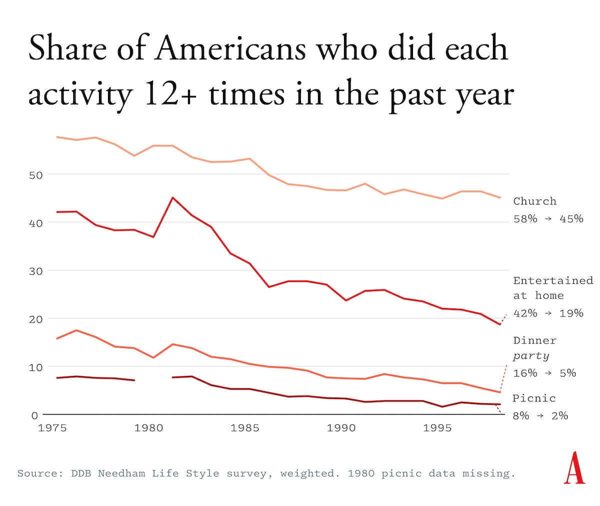
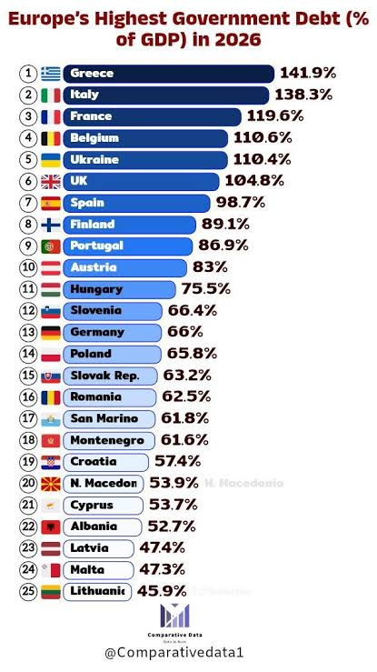
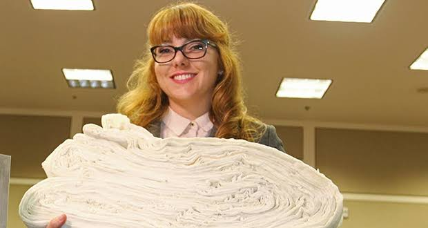
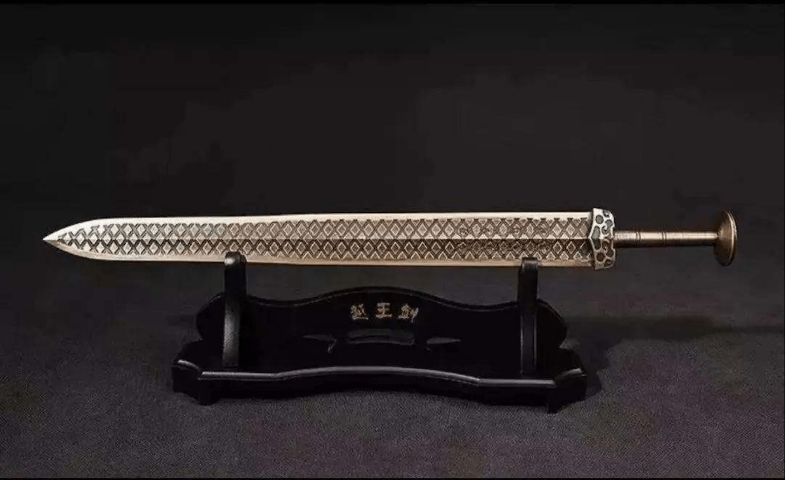

## Editor's Words

Two years ago, I managed to acquire all the platinum badges on PS5 for Black Myth: Wukong. Rednote app was a huge help as players shared their tips and videos. It was fun to flip through all kinds of struggling stories from other people.

Phantom Blade Zero looks to be another standout 3A console game from China, with rave reviews from fans around the world. The word in the street goes, "the second kid from the village that went to a college”. 

Rednote is still the final destination of all mankind’s answers. But I don’t flip through that many posts from other humans anymore. Rednote launched its own in-app AI service - DotDot (every aspiring social media platform has one now). DotDot browses through many users’ posts and summarizes their findings for me. I just chat with DotDot to get my tips. 

DotDot’s notes are a lot more comprehensive and accurate, but they're just not as fun as what they used to be, or could have been, when they were written by humans.

It’ll take a bit of getting used to. In some way, the Sunday Blender is also an elegy to the old-fashioned weekly newspaper, when they were both written and read by humans. 

## Tech

**DeepSeek Harness**, a free tool released by the Chinese AI company **DeepSeek** in August, has grown faster than any software project in the history of **GitHub**, the website where programmers share code. Users “star” projects they like, and Harness gained nearly `75,000` stars on its first day, more than any project had ever gained in a single day, then passed `200,000` in 15 days. Before this year, only three software projects had ever reached 200,000 stars, including the **Linux** operating system, and each took about a decade. Earlier this year, the AI assistant **OpenClaw** set a new record by getting there in `84` days. By November 6, Harness had nearly 274,000. The software turns an AI model into an “agent” that can carry out tasks on a computer, such as reading files, writing code, and searching the web. Every part of it is a plugin that can be swapped out, including the AI model itself, so it also works with rival companies’ models and can hand jobs to competing coding agents such as **Claude Code** and **OpenAI**’s **Codex**. DeepSeek says about `1.5 million` people used Harness on November 4, up from roughly `271,000` a day at the start of October.

**Hongguo**, a free app for watching short dramas owned by **ByteDance**, the company behind **TikTok**, has become one of China’s most-used apps only three years after launching. Its episodes last one to three minutes, and viewers pay nothing but sit through short ads. According to the research firm **QuestMobile**, Hongguo had about `168 million` daily users in July, more than four of China’s biggest video-streaming services combined, and each user spent about two hours a day on it, longer than people spend on the messaging app **WeChat**. Many of its shows are now made with AI. The top AI series on the app, **Entering the Song Dynasty Armed**, was produced by a core team of 10 led by Zhang Hansheng, a 54-year-old whose earlier businesses had failed and who taught himself AI video-making last year. The team generated the scenes, sound, and voices with **Seedance**, ByteDance’s AI video tool, and did the final editing in **CapCut**, ByteDance’s video-editing app. His wider team of more than 30 people, many of whom started part-time, works entirely online from six provinces; members reportedly include a stay-at-home mother, a former ride-hailing driver, and a small-truck driver. The team spent more than `$140,000` on computing power to generate the series, which has been played more than `6.6 billion` times across the internet.hong

Magnetic tape, the technology behind old music cassettes, is making a comeback thanks to artificial intelligence. On October 29, **Fujifilm** announced it will spend about `$63 million` to make five times as much data-storage tape at its factory in Odawara, Japan, its biggest investment ever in tape production. AI companies create mountains of data, such as old training datasets and earlier versions of their models, that they rarely use but cannot simply delete. Tape is a cheap way to keep it, because a cartridge sitting on a shelf uses no electricity, and hackers cannot reach data that is not connected to any network. Fujifilm’s newest cartridge is about `10 centimeters square` and `2 centimeters` thick, yet it holds `1,337 meters` of tape, enough to store `40 terabytes`, about `400` times more than the first version from 2000. **CERN**, the European physics lab, keeps most of its 1 exabyte (a million terabytes) of particle-collider data on about `60,000` tapes.

## Global

Shanghai’s **JZ Festival**, the biggest jazz festival in China and the second-biggest in Asia, wrapped up on November 1 after 17 days of music. Its 22nd edition was also its largest: more than `100` musicians from over `20` countries and regions played `146` performances across `13` venues. The festival was founded in 2005 by Ren Yuqing, who owns **JZ Club**, a jazz club in Shanghai. This year it opened with a Jazz Age Carnival in Qiantan Sports Park, where visitors browsed classic cars, vinyl records, and retro clothing while bands played. All outdoor concerts were free. Headliners included American trumpeter **Theo Croker**, Chinese soul singer **Tia Ray**, and bassist **Victor Wooten**, a five-time Grammy winner whom **Rolling Stone** readers voted one of the 10 greatest bassists of all time, who played the closing weekend with his brothers.

Fifty years ago, `42%` of Americans had friends or family over to their homes at least once a month. Today only `12%` do, a drop of `70%`, according to new polling by the research group Data for Progress, which repeated questions from surveys first asked in the 1970s. Writer Derek Thompson, who reported the numbers in **The Atlantic**, points to several causes. Many more households now have two working parents, leaving less time to plan, shop, cook, and clean. Parents also spend far more time caring for their children than earlier generations did. Streaming and social media have made it easy to be entertained at home alone, and people today have fewer close friends to invite. Americans are not simply meeting at restaurants instead: researchers find that time spent at home has risen sharply since the 2010s, while time spent with other people in person has fallen.

The **Ebola** outbreak in the **Democratic Republic of the Congo** (DRC) is now the deadliest the country has ever faced, and the second-deadliest anywhere since the disease was identified there in 1976. Since May, health officials have confirmed more than `10,700` cases and more than `5,200` deaths. Only the **West Africa** epidemic of 2014 to 2016, which infected about `28,600` people and killed more than `11,300`, was worse. It is the DRC’s 17th Ebola outbreak, and it comes from a rare species called Bundibugyo, which has no approved vaccine or treatment. Armed conflict and weak health services in the region make it hard to find and treat every patient. The virus has also crossed borders: Uganda had cases, but its outbreak has since ended, **Kenya** recorded its first Ebola cases ever in October, and a traveler who had been in Uganda tested positive in **Nigeria**. On November 5, health officials announced that two vaccines designed specifically for Bundibugyo will join a trial in the DRC.

Early on Tuesday, November 3, almost `3 million` people in **Paraguay** opened their banking app and found a blank screen. **Ueno**, the country’s largest digital bank, had been taken over by Paraguay’s central bank, which found it no longer had enough money of its own to cover its losses. Its customers, roughly `60%` of the country’s adults, suddenly could not withdraw cash, send payments, or use their cards. Ueno had grown quickly by offering supermarket discounts, and more than a million Paraguayans had opened their first bank account there. Some workers were left without their wages, and the bank also managed about `$800 million` in public money, including about `$380 million` from the state pension and health fund. Deposits are insured up to about `$35,000`, which covers `97%` of Ueno’s customers, and lawmakers passed a law to repay the smallest accounts first. The collapse also cost President Santiago Peña his job: his government had close ties to the bank, and he resigned on November 5.

Spanish football is mourning Jesús de Miguel, a 30-year-old striker for **CD Tenerife**, who died on November 3, a day after being injured in a match. In the final seconds of Tenerife’s second-division game against **FC Andorra**, de Miguel was chasing the ball near the halfway line when Andorra’s goalkeeper, who had run far out of his goal to clear it, collided with him at full speed. The match, tied 2-2, was stopped and never finished. De Miguel’s heart stopped in the ambulance on the way to hospital, and he died the next morning. Spain’s football federation called off its national cup matches that day, and teams in the Champions League paid tribute to him. Fans left flowers outside Tenerife’s stadium. Spanish police have opened an investigation, which Spanish law requires whenever a death is not from natural causes.

## Economy & Finance

Stock markets around the world had a rough week after **Democrats** won control of the **US Congress** in Tuesday’s midterm elections. Prices first rose on Wednesday, as investors were relieved the results came in quickly and clearly. On Thursday they turned sharply lower, and the tech-heavy **Nasdaq** index fell `5.5%`, **Wall Street**’s worst day since April 2025, with chipmakers such as **Nvidia** hit hardest. Investors worry the new Congress could slow the building of AI data centers, which face widespread public opposition, and bring tighter rules for AI companies. On Friday the selling spread to Asia, where chipmakers make up a big part of the stock markets. South Korea’s main index dropped more than `8%` soon after opening, triggering an automatic 20-minute pause in trading, and closed down `6%`. Japan’s Nikkei also fell `6%`. China was hit less: the main indexes in Shanghai and Hong Kong each slipped about `1%`, though Chinese companies that sell data center parts to America fell much further.

**France**’s government owes about `119%` of everything its economy produces in a year, roughly double the limit set by European Union rules. The debt keeps growing because the government spends more than it collects in taxes, and lenders are now charging France more to borrow. To slow the borrowing, the government’s draft budget for next year would freeze most spending and find savings in pensions and health care. Since mid-September, high school students across France have been blocking school entrances to demand more money for understaffed schools, and the protests later spread to universities. Some turned violent, with fires set in the streets and hundreds of arrests. Student leaders say the government’s offers so far fall short of what they are asking for. The government is under pressure to spend less at the same time that students are demanding it spend more on schools.

## Nature & Environment

Autumn color moves across the Northern Hemisphere like a slow wave, and this week the best place to see it is China. In **New Hampshire** and **Vermont**, famous for their maples, the leaves peaked in early and mid-October, and by late October most of Vermont was past its best. In Japan, the wave is still moving south: **Sapporo** in the far north peaked in early November, while **Tokyo** and **Kyoto** are not expected to peak until late November and December. In China, trees are at their brightest across a wide band of the north and center, from southern Hebei and Shandong to Henan and Sichuan. In **Beijing**, most of the red comes not from maples but from smoke trees, which make up more than `100,000` of the `140,000` colorful trees on **Fragrant Hills**. Leaves change color when cool weather breaks down their green chlorophyll and the trees start making red pigments. Beijing’s smoke trees begin to turn only after three days in a row of nights below `14°C` and days more than `10°C` warmer.

## Science

In 2022, **NASA** deliberately crashed a spacecraft called **DART** into a small asteroid named **Dimorphos**, to test whether humans could push a space rock off course if a dangerous one were ever found heading for Earth. It worked: Dimorphos, about `170 meters` across, now takes about `33 minutes` less to circle its larger partner, Didymos, making it the first object in the Solar System whose orbit humans have measurably changed. Neither asteroid poses any danger to Earth. Europe’s Hera spacecraft has now arrived to investigate the crash, and on November 5 it sent back its first close-up image, taken from about `60 kilometers` away, nearly `197 million kilometers` from Earth. The picture shows a side of Didymos that DART never saw, marked with strange grooves that scientists think may come from debris thrown off Dimorphos by the impact. Hera will study both asteroids for at least six months, and one of its two small probes will use radar to look inside Dimorphos. The first detailed images are due on November 25.

## Math

For years, people believed a sheet of paper could not be folded in half more than `7` times. Each fold doubles the number of layers, so after seven folds one sheet has become `128` layers, a lump about as thick as a notebook and too stiff to bend. At `50` folds, the stack would be more than `100 million` kilometers tall, about three-quarters of the way to the Sun. The folded edge adds a second problem: the outer layers must curve around the inner ones, and that curve uses up more paper with every fold. In 2002, Britney Gallivan, an American high school student, worked out a formula for how long a strip must be to survive a given number of folds. It said she needed about `1.2 kilometers` of thin paper for `12` folds, so she bought a giant roll of toilet paper, spent seven hours folding it in a shopping mall, and broke the seven-fold rule.

## Lifestyle, Entertainment & Culture

**Diwali**, the festival of lights, falls on Sunday, **November 8** this year, on the darkest night of the month, when there is no moon. Its best-known story comes from an ancient Indian poem: a prince named Rama came home after 14 years away and a victory over a ten-headed demon king, and the people of his city lit rows of clay oil lamps to guide him back. Families clean their homes, draw colorful patterns on the ground at their front doors, share sweets, set off fireworks, and pray for good fortune. In 2025, the city of **Ayodhya**, where Rama is said to have come home, lit more than `2.6 million` oil lamps along its riverbanks at the same time, a Guinness World Record counted by drones. Seven weeks later, **UNESCO** added Diwali to its list of the world’s living cultural heritage.

**Phantom Blade Zero**, an action game from the Chinese studio **S-GAME**, sold more than `4 million` copies in the first 72 hours after its release in late October on **PlayStation 5** and PC, about 15 copies every second. On **Steam**, the biggest store for PC games, more than `833,000` people were playing at the same time at its peak, and about `90%` of nearly `80,000` player reviews are positive. Players control an assassin on a mission to restore his heart and uncover the plot that condemned him. The game’s world draws on **wuxia**, the Chinese tradition of martial-arts stories, mixed with elements from other genres in a style the studio calls “**kungfupunk**,” and its music blends traditional Chinese instruments with modern sounds. It is S-GAME’s first big-budget game for consoles and PC. It follows **Black Myth: Wukong**, the Chinese game based on the classic novel **Journey to the West**, which sold `10 million` copies in its first 72 hours in 2024.

## Sports

**Luka Dončić**, the Slovenian star of the **Los Angeles Lakers**, has made one of the best scoring starts to a season in NBA history. After nine games, he leads the league with an average of `40.1` points per game, and he has scored `40` or more six times, including in each of his last four games. Through his first eight games, he scored `308` points, more than any player since 1988, when **Michael Jordan** scored `303` at the start of the season. Dončić has also set a record no player had reached before: seven straight games with at least `35` points, `5` rebounds, `5` assists, and `5` three-pointers. On November 6, he scored `53` points against the **Portland Trail Blazers**, including a shot from beyond half court at the end of the first half, and the Lakers have won eight of their first 10 games.

**Como**, an Italian club playing in the **Champions League** for the first time, beat the French side **Lens** `9-1` in Lens on November 4, one of the most remarkable results in the competition’s history. No team had ever scored nine goals in an away game in the Champions League, or won an away game by such a wide margin. The eight-goal gap equals the competition’s overall record, shared with **Liverpool**’s 8-0 win over **Beşiktaş** in 2007 and **Real Madrid**’s 8-0 win over **Malmö** in 2015. Como became only the second team, after **Bayern Munich**, to score nine in a Champions League match, and the first team in Europe’s top club competition to score nine away from home since 1971. It was also the heaviest Champions League defeat ever suffered by a French club. Como, from a small city on the shores of **Lake Como** in northern Italy, is coached by **Cesc Fàbregas**, the former Spain midfielder, and has climbed to fourth place in the standings in its debut season.

South Korea’s **An Se-young**, the world’s top-ranked women’s badminton player, won the **Korea Open** on November 8, her `11th` title of the season. She beat Japan’s **Akane Yamaguchi**, the world No. 2, 21-12, 15-21, 21-16 in the final in Yeosu, winning the last five points of the match. Eleven titles in one season ties the badminton record, set by Japan’s men’s champion **Kento Momota** in 2019 and matched by An herself last year, and she is the first player ever to do it in two straight seasons. The 24-year-old has won 11 of the 12 tournaments she entered this year, and her only loss in `72` matches came in the final of the **All England Open** in March. She has now won `55` matches in a row. If she wins the **World Tour Finals** next month, she will hold the record for the most titles in a season by any player, man or woman.

## This Day in History

On **November 8, 1602**, the **Bodleian Library** at the **University of Oxford**, now one of the oldest libraries in Europe, opened its doors to readers. A former diplomat named Thomas Bodley had paid to rescue the university’s old library, which had fallen into ruin, and filled it with more than `2,000` books. Bodley wanted scholars from beyond Oxford to use it too, and readers soon traveled from across northern Europe to study there. In 1610, he struck a deal to receive a copy of every book printed in England, an arrangement that continues today. Together, the Bodleian Libraries now hold more than `13 million` printed items. None of the books can be borrowed: in 1645 even **King Charles I** was refused, and new readers still promise not to bring any fire or flame inside. Two of its oldest rooms appeared in the **Harry Potter** films: Duke Humfrey’s Library became the Hogwarts library, and the Divinity School below it became the hospital wing.

## Art of the Week

Legendary kings have legendary swords, but most, like **King Arthur**’s **Excalibur**, exist only in stories. A bronze sword in China has survived more than `2,400` years with its owner’s name written on the blade. Archaeologists found it in December 1965 in an ancient tomb in central China, tucked inside a wooden sheath, and when they cleaned it the next day, the blade showed no rust. One of the archaeologists who dug it up easily sliced through 20 sheets of paper with it. Eight bird-shaped characters on the blade read: “**King of Yue**, Jiuqian, made this sword for his own use.” More than ten of China’s leading scholars traded more than 40 letters over several months before confirming that Jiuqian meant **Goujian**, one of China’s most famous kings. In 494 BC, Goujian’s army was crushed by the neighboring kingdom of Wu, and he spent three years as a servant to its king, Fuchai. Back home, he slept on brushwood and tasted a bitter animal gallbladder every day so he would never forget his humiliation. In 473 BC, his rebuilt army conquered Wu, and Fuchai took his own life. How Goujian’s sword ended up in a tomb of the Chu kingdom, centered in today’s Hubei province, is still debated. Today it is displayed at the **Hubei Provincial Museum** in **Wuhan**, which also holds a spear that belonged to Fuchai.

## Funny

---

## Previous Issues

---

November 01, 2026, **[Free As A Bird](https://weekly.sundayblender.com/p/free-as-a-bird/)**

October 18, 2026, **[Back to the Future With Tesla](https://weekly.sundayblender.com/p/back-to-the-future-with-tesla/)**

October 04, 2026, **[Flowers and Crayfish in the Desert](https://weekly.sundayblender.com/p/flowers-and-crayfish-in-the-desert/)**

---

Thanks for reading! If you enjoy this newsletter, please share it with friends who might also find it interesting and refreshing, if not for themselves, at least for their kids.

