## Editor's Words

One of the main reasons for me to hand-roll the Sunday Blender two years ago is that none of the traditional Western media can give what I want. They are either too political, or too biased, or are simply distorting reality with fabricated narratives. 

They were once viewed as holding the torch for the intellectuals in the West, but what they have been doing in the last few days shows how much they have fallen into the abyss in recent years. There is no dignity. There is no honor. There is no journalism. They are despicable.

Happy to report that I stopped reading the following media years ago:

- The New York Times
- Washington Post
- The Economist
- The Wall Street Journal
- The Atlantic

Can’t let them poison the minds of our children.

## Tech

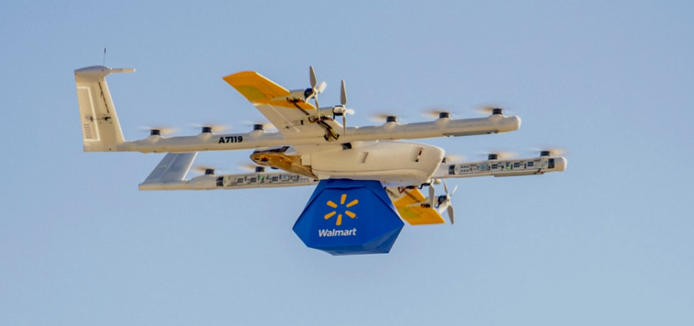

Shoppers around **Memphis**, Tennessee, can now have their groceries delivered by air. On November 10, **Wing**, the drone company owned by Google’s parent **Alphabet**, began flying **Walmart** orders from three stores in the area, putting tens of thousands of homes in range. Customers choose from thousands of everyday items, from groceries to household goods and baby products, and the order can arrive in as little as `30` minutes. The drones cruise at up to `60` miles (about `100` kilometers) an hour. When one reaches a home, it hovers about seven meters above the yard and lowers the package on a cord, so it never has to land. Each flight carries one small order of up to about `1.2` kilograms. Memphis is the sixth metro area where the two companies fly together, after Dallas-Fort Worth, Atlanta, Houston, Charlotte and Orlando, and their service now reaches more than three million customers. Walmart aims to offer drone delivery from more than `270` stores by 2027, and Wing is spending up to `$125 million` on a factory in Texas that will build tens of thousands of drones a year.

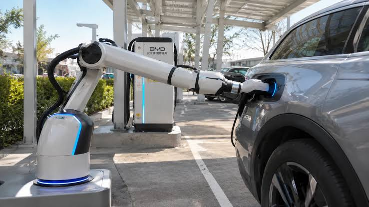

**BYD**, the Chinese electric car maker, has shown off a charging station where a robot plugs in the car for you. At a demonstration in the desert outside **Abu Dhabi** in the **United Arab Emirates**, a robotic arm used cameras to find a car’s charging port, opened its cover, pushed in the heavy connector, and pulled it out again once charging was done. Sensors let the arm feel how hard it is pressing, so it lines up the plug without human help. The charging itself is extremely fast: BYD says its Flash chargers can take a compatible car from `10%` to `70%` in five minutes, about the time it takes to fill a tank with petrol. The station also makes its own power. Solar panels feed large batteries on site, so it can run without a connection to the electricity grid, which suits places where power lines are scarce. Paired with BYD’s self-parking feature, a driver could step out and let the car park and charge itself. BYD calls it the first station to combine all of these, though the robot arm is still a prototype.

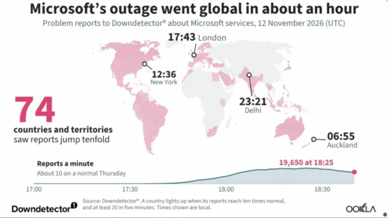

On Thursday, November 12, **Microsoft**’s **Outlook** email went dark around the world, and **Teams**, **Copilot**, **Word** and **Excel** stumbled along with it. Microsoft has more than `450 million` paid work accounts on these tools, so offices, schools and government agencies lost their main way of keeping in touch. Reports of problems came from `74` countries, and the outage dragged into a second day. It was not a hack. A network upgrade went wrong, and as servers dropped offline, the ones left running had to carry more and more of the load while early fixes failed. One glitch can reach this far because so much of the internet now runs through a handful of companies. **Amazon**, **Microsoft** and **Google** together take about `60%` of the world’s spending on cloud computing, the rented computer power that many apps and websites run on. When Amazon’s cloud broke in October 2025, **Fortnite**, **Roblox**, **Snapchat** and **Duolingo** all went down at the same time.

## Global

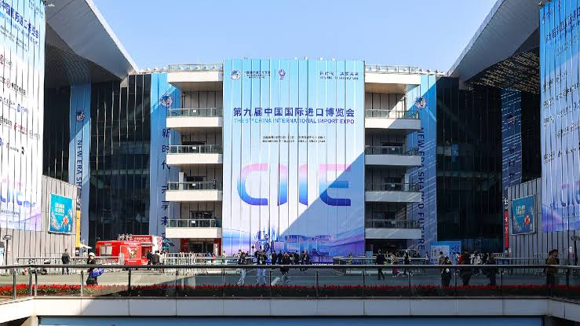

In 1851, at the height of Britain’s industrial revolution, **London** hosted the **Great Exhibition**, the first world expo, a giant showcase of the machines and goods that Britain and other nations could make and sell. This month’s **China International Import Expo** in **Shanghai** works the other way round. First held in 2018 as the world’s first national-level expo dedicated to imports, it invites other countries to come and sell to Chinese buyers. This year it set aside a zone for about `100` “national favorite” brands, everyday products that people in their home countries have trusted for generations but that few shoppers in China have heard of. About 30 are more than a century old, including British porcelain maker **Royal Crown Derby**, founded in 1750. Sales of Sri Lankan black tea rose tenfold compared with a year earlier, and online sales of British butter biscuits tripled during the six-day fair. One newcomer, **Mackie’s**, is selling in China for the first time. Its ice cream is made on a farm in northeast Scotland that the Mackie family has run for more than a century, using milk from its own cows and electricity from four wind turbines on the hill above the dairy.

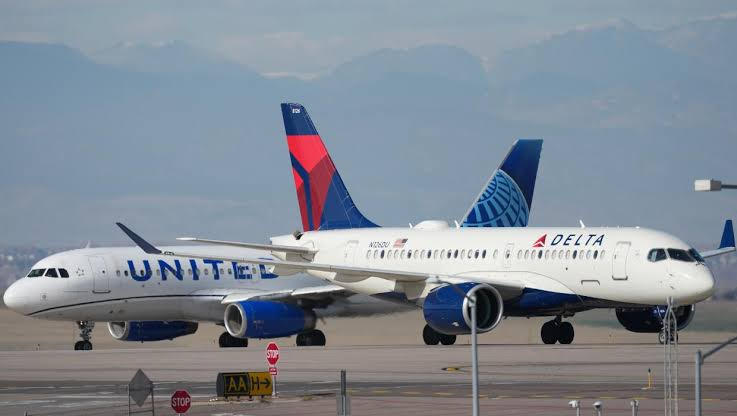

For more than four hours on Friday afternoon, November 13, no flight was allowed to take off from any airport in the United States. The **Federal Aviation Administration**, which runs American air traffic control, ordered the rare nationwide “ground stop” after a communications failure hit the centers that guide planes once they climb above `18,000` feet. There are `22` of these centers, and their controllers talk to pilots over radio channels to keep cruising planes safely apart. With those channels failing, the safest choice was to keep new flights on the ground while the thousands of planes already in the air were guided down to land. Officials said there was no sign of a cyberattack and pointed to a telecommunications problem. More than `10,000 `flights were disrupted, and delays are expected to stretch into the weekend. The last time the whole country was grounded, in January 2023, a failed computer system that sends safety notices to pilots was to blame.

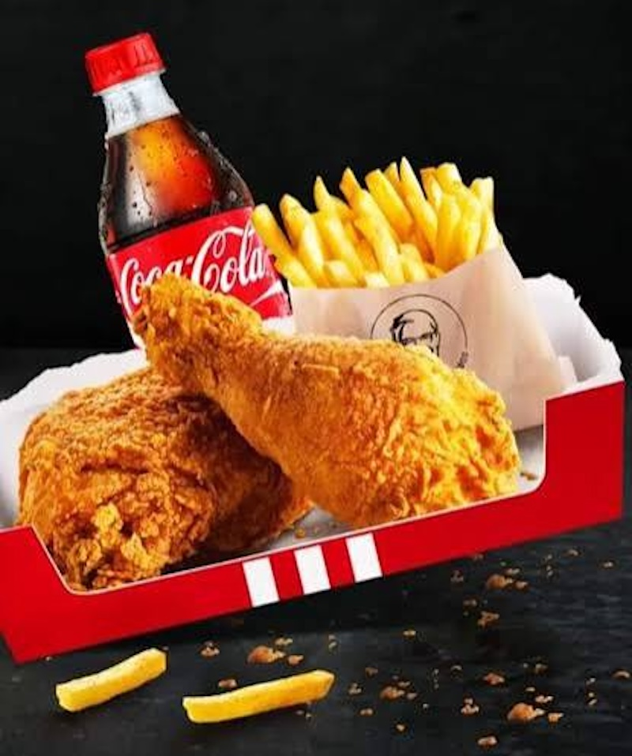

**KFC** restaurants in the United States are switching from **Pepsi** to **Coca-Cola**, ending a drinks partnership that has lasted about 40 years. The two companies announced the deal in October. The change begins in January 2027, and Coca-Cola drinks should be on sale at all of KFC’s roughly `3,700` US restaurants by spring. The link with Pepsi goes back to 1986, when PepsiCo bought KFC. In 1997, PepsiCo split its restaurants off into a separate company, now called Yum Brands, but KFC kept serving Pepsi anyway. KFC’s US president, Catherine Tan-Gillespie, said the switch is part of an effort to modernize the chain and its menu. KFC has already been testing new drinks, including lemonades, boba refreshers and shakes, at a new-style restaurant in Texas. Outside the US, KFC will keep serving Pepsi.

## Economy & Finance

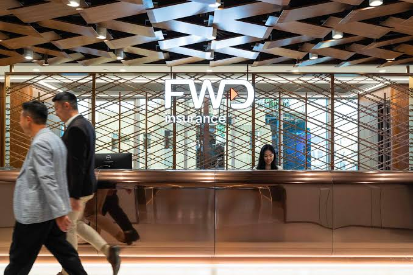

A `$318 million` life insurance policy has been certified by **Guinness World Records** as the most valuable ever issued. With life insurance, a person pays an insurer money over the years, and when they die, the insurer pays an agreed sum to their family. The record policy came from FWD, an insurance group founded by billionaire **Richard Li**, the younger son of Hong Kong tycoon **Li Ka-shing**, and was sold to a client the company did not name. For the very rich, a policy this size is less about protection than planning: it is a way to keep a fortune safe and hand it to the next generation. The record has now been broken three times in under three years, first by **HSBC** in Hong Kong in 2024, then by **Manulife** in Singapore this February, and industry experts expect more as wealth across Asia keeps growing. The record before that, `$201 million` set in 2014 for a Silicon Valley billionaire, had to be split among 19 insurance companies.

## Nature & Environment

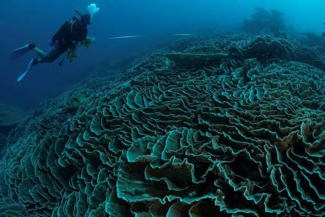

Divers off the Cocos (Keeling) Islands, a remote Australian territory in the **Indian Ocean**, have mapped a rose coral that stretches `1.56 kilometers`. That is about as long as 15 soccer fields end to end, or a 20-minute walk. A local dive operator first spotted parts of it more than 30 years ago, but no one knew how far it went. When a team led by JP Hobbs tried to measure it, divers kept running out of air before reaching the end, and it took 12 dives to map the whole thing. A coral is made of tiny animals called **polyps**, relatives of jellyfish. When the polyps all grow from one baby coral, they share the same genes and work together like one living thing. The biggest single coral known, found near the Solomon Islands in 2024, is `34 meters` wide, wider than a blue whale is long. Scientists have taken about 50 samples along the Cocos coral to test whether it is one giant or many neighbors. The same kind of test showed in 2022 that a seagrass meadow stretching `180 kilometers` in Australia’s Shark Bay is a single plant, the largest living thing known.

## Science

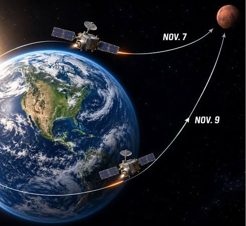

Two small **NASA** spacecraft nicknamed Blue and Gold are on their way to Mars after a year-long detour. The robotic twins, part of a mission called **ESCAPADE**, launched in November 2025 but did not head straight for Mars. They circled a point about `1.6 million` kilometers from Earth, on the side facing away from the Sun, while Earth and Mars moved into better positions. On November 7 and 9, each swung back past Earth and fired its engine for about nine minutes, using Earth’s gravity as a slingshot. NASA had never sent a spacecraft to Mars this way before. Billions of years ago, Mars had a much thicker atmosphere. Unlike Earth, it has no global magnetic field to protect it, so the solar wind, a constant stream of charged particles from the Sun, has been stripping its air away. With only one spacecraft, it is hard to tell whether a change it measures is happening across the planet or only where it is flying. With two, one can measure the solar wind heading toward Mars while the other watches how the planet’s air responds at almost the same moment. Blue and Gold are due to reach Mars in September 2027.

## Math

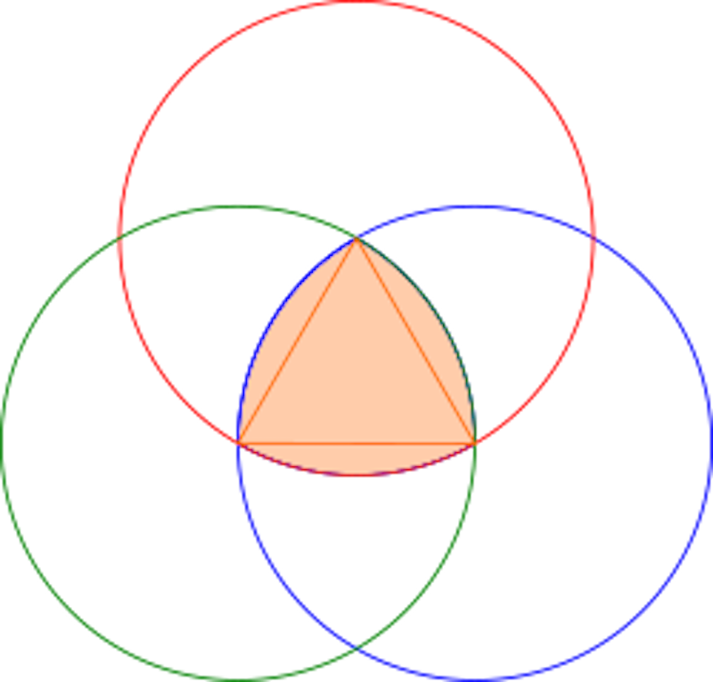

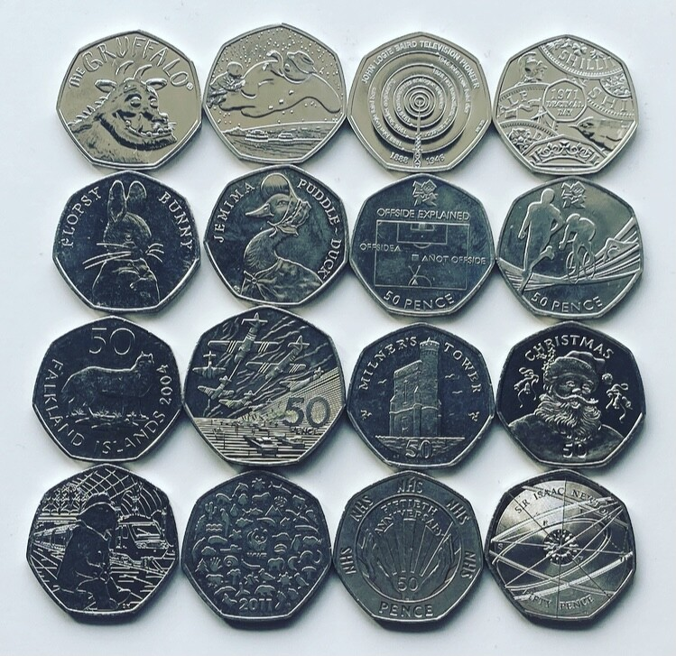

A round manhole cover can never fall through its own hole, because a circle is the same width in every direction. A square cover can: turn it on its edge, and it drops through the hole’s diagonal. The circle is not the only shape that works. **The Reuleaux triangle**, a triangle with bulging curved sides, also measures the same width however it is turned. To draw one, make a triangle with three equal sides, put a compass point on each corner, and draw an arc between the other two. Britain put the same idea into people’s pockets in 1969 with its flat 50p coin, which has seven slightly curved sides. The Royal Mint wanted a coin that was easy to tell apart from round ones in a pocket, but it also had to work in vending machines, which recognize coins by measuring their width. The world’s first seven-sided coin did both. Spin a Reuleaux triangle inside a square, and it touches all four sides the whole time, which is how special drill bits cut holes that are almost perfectly square.

## Lifestyle, Entertainment & Culture

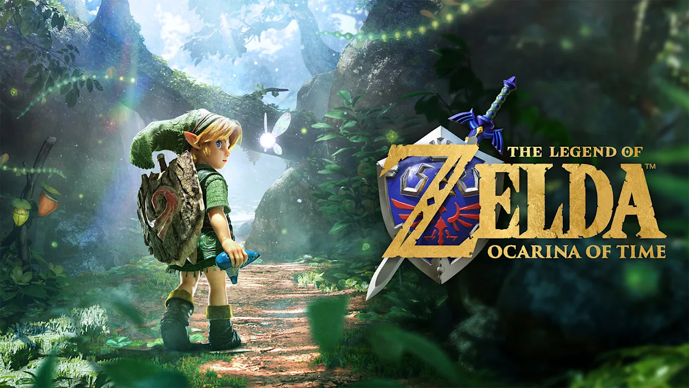

The Switch 2 remake of The Legend of Zelda: Ocarina of Time sold more than 5.2 million copies worldwide in its first four days, the fastest start of any game Nintendo has published for the console. The original Nintendo 64 version sold 7.6 million copies over its entire life. Released in 1998, it is still the only game ever to score 99 on Metacritic, which averages the reviews of professional critics, and Guinness World Records lists it as the most critically acclaimed video game of all time. The remake scored 96, the highest of any game released this year. The series has grown far bigger since 1998. Breath of the Wild, released in 2017, has sold more than 34 million copies on Switch, and its 2023 sequel, Tears of the Kingdom, nearly 23 million. Next, the series moves to cinemas. A live-action film called simply The Legend of Zelda, with an original story rather than the plot of any one game, opens worldwide on April 30, 2027.

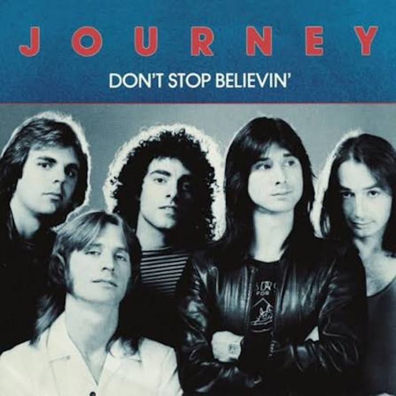

**Journey**, a rock band formed in San Francisco in 1973, is best known for “**Don’t Stop Believin’**,” a 1981 song that starts with a famous piano opening. The line that gives the song its title doesn’t arrive until the last 50 seconds. Its hopeful message made it a favorite in sports. The **Chicago White Sox** adopted it as their theme when they won baseball’s World Series in 2005, and the **San Francisco Giants** have long played it at home games. Other hits include “**Open Arms**,” “**Faithfully**” and “**Any Way You Want It**.” The band’s current singer, Arnel Pineda, was singing in bars in Manila, in the Philippines, when guitarist Neal Schon found his videos on YouTube in 2007. After more than 50 years, Journey is still touring. This year’s tour ends with a hometown show in San Francisco on November 28, and the band has booked a concert for 2027.

**Grand Theft Auto VI** comes out on Thursday, November 19, the first new game in the series in more than 13 years. Its big draw is the open world. Instead of moving from level to level, players roam freely through a whole living place, with traffic, changing weather, and crowds of people going about their day. The series helped make this style famous: Grand Theft Auto III, released in 2001, is widely credited as the game that made 3D open worlds popular, and franchises from **Spider-Man** to **The Legend of Zelda** later followed. GTA VI is set in Leonida, a made-up version of Florida built around Vice City, and Rockstar says its map is about twice the size of GTA V’s. For the first time in the main series, one of the lead characters is a woman. The game’s first trailer drew more than `90 million` YouTube views in a single day. Like every main game in the series, it is rated for adults: M for Mature 17+ in North America and 18 in Europe.

## Sports

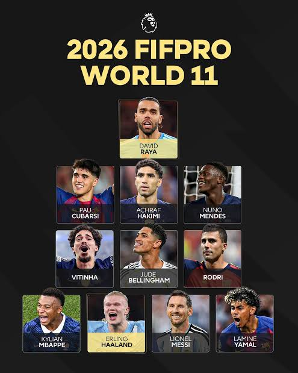

**Harry Kane** won the **Ballon d’Or**, football’s most famous individual prize, in October, yet his fellow players have left him out of their team of the year. The **FIFPRO Men’s World 11** is picked by `19,806` professional footballers from `73` countries, and Kane, who scored `73` goals in `65` games for **Bayern Munich** and **England** last season, did not make the final eleven despite being on the 26-man shortlist. **Cristiano Ronaldo**, also shortlisted, missed out too. The gap comes down to who votes: the Ballon d’Or is decided by journalists, while the World 11 shows what players think of each other. The four attacking places went to **Lionel Messi**, **Kylian Mbappé**, **Erling Haaland** and **Lamine Yamal**. It was Messi’s 18th selection, extending his own record, and the 19-year-old Yamal became the first player picked twice before turning 20.

**Italy** beat **France** `3-1` in Milan on November 12, Italy’s first home win over France since 1962. It was also the first loss for **Zinedine Zidane**, the former French star player who took over as France’s coach this summer. France scored first through **Michael Olise**, but Italy came back. Francesco Pio Esposito scored twice, and Davide Frattesi added the other goal. Pio’s brother Sebastiano also played and missed a penalty kick. They are the first brothers to play for Italy together since 1910. The game was part of the **Nations League**, a competition between European national teams. The win moved Italy to the top of its group, ahead of France because it has scored more goals. If Italy avoids losing to Belgium on November 15, it reaches the quarterfinals.

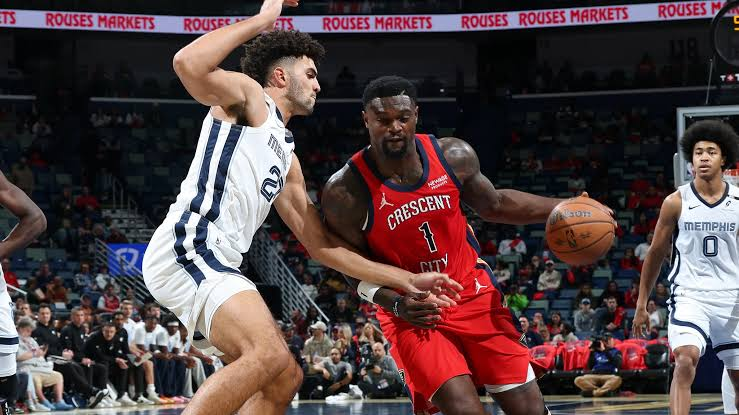

The **Memphis Grizzlies** beat the **New Orleans Pelicans** `142-111` on November 13, with 10 Memphis players scoring at least 10 points each. That matched the NBA record for the most players on one team reaching double figures in a single game. Jerami Grant led the way with 22 points off the bench, and nine teammates scored between 10 and 17. The game was part of the NBA Cup, a tournament played during the regular season. Memphis made 18 three-pointers and won its sixth straight road game, the best start away from home in the team’s history. For New Orleans, Saddiq Bey scored 30 points, the most by any Pelicans player this season, but the team still lost its fifth game in a row.

No Chinese player reached the singles semifinals at **WTT Champions Frankfurt**, a top event on table tennis’s professional tour, held in Germany from November 3 to 8. All four Chinese players left in the quarterfinals lost on November 7. Japan’s **Tomokazu Harimoto** won the men’s title and fellow Japanese player **Hina Hayata** won the women’s. Across this year’s six Champions events, Chinese players won just one of the 12 singles titles, and the men’s world No. 1 is now **Sora Matsushima**, a 19-year-old from Japan. Germany’s national news agency wrote that Chinese dominance is over. China’s own state news agency described a team in the middle of replacing older stars with younger ones, with top player **Wang Chuqin** missing events through injury and rival men’s players closing the gap. China’s women still won the world team championship in London this year.

## This Day in History

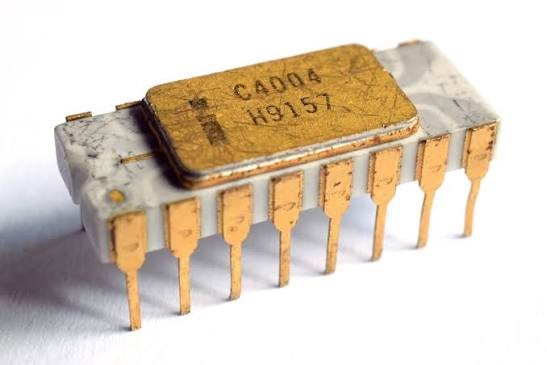

On **November 15, 1971**, **Intel** ran an advertisement in the trade magazine Electronic News announcing “a new era in integrated electronics.” It was introducing the **Intel 4004**, the first microprocessor sold to the public. Designed for a Japanese calculator maker, the chip was the size of a fingernail and held about `2,300` transistors, yet it matched the power of a 1946 computer that filled an entire room. A processor like the 4004 works through instructions one after another, very quickly. In 1993, **Jensen Huang** co-founded **Nvidia** to build a different kind of chip, one that runs thousands of small calculations at the same time to draw every pixel of a video game. Nvidia called its **GeForce 256** “the world’s first GPU” in 1999. In 2006, it let programmers use those chips for work beyond graphics. Training AI turned out to need the same kind of math, done over and over at the same time, and Nvidia’s GPUs became the engine of the AI revolution. In October 2025, Nvidia became the first company in history to be worth `$5 trillion`, more than **Intel**, **AMD**, **Qualcomm** and **Micron** combined. Jensen Huang is widely regarded as one of the greatest tech visionaries and entrepreneurs, along with **Steve Jobs** of **Apple** and **Elon Musk** of **SpaceX/Tesla**.

## Art of the Week

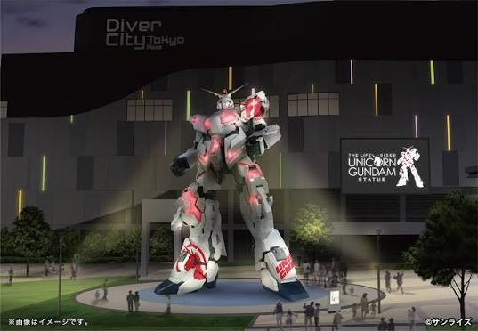

For almost nine years, a giant robot stood outside a shopping mall in **Odaiba**, Tokyo. The **Unicorn Gundam** statue was `19.7 meters` tall, about as high as a six-story building, and life-size, meaning it was built at the same size as the robot in the story. **Gundam** is a Japanese animated series, first shown on TV in 1979, about pilots who fight inside giant robot suits. Several times a day, parts of the statue moved and opened, switching it from its “Unicorn Mode” to its “Destroy Mode,” just as the robot does on screen. At night it was lit up while videos played on the mall’s wall beside it. It became a landmark that drew visitors from Japan and overseas. The statue’s display ended on August 31, two days after a farewell ceremony that fans attended in light rain.

## Funny

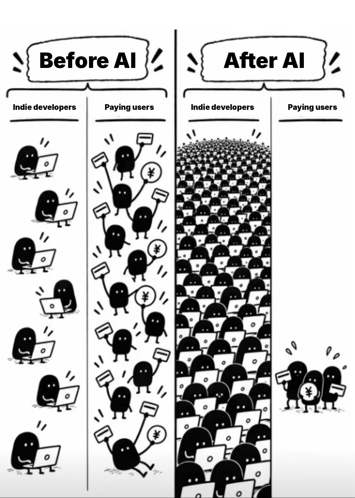

---

## Previous Issues

---

November 08, 2026, **[The Revenge of the King](https://weekly.sundayblender.com/p/the-revenge-of-the-king/)**

November 01, 2026, **[Free As A Bird](https://weekly.sundayblender.com/p/free-as-a-bird/)**

October 18, 2026, **[Back to the Future With Tesla](https://weekly.sundayblender.com/p/back-to-the-future-with-tesla/)**

---

Thanks for reading! If you enjoy this newsletter, please share it with friends who might also find it interesting and refreshing, if not for themselves, at least for their kids.

