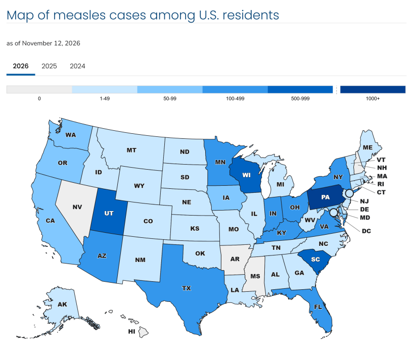
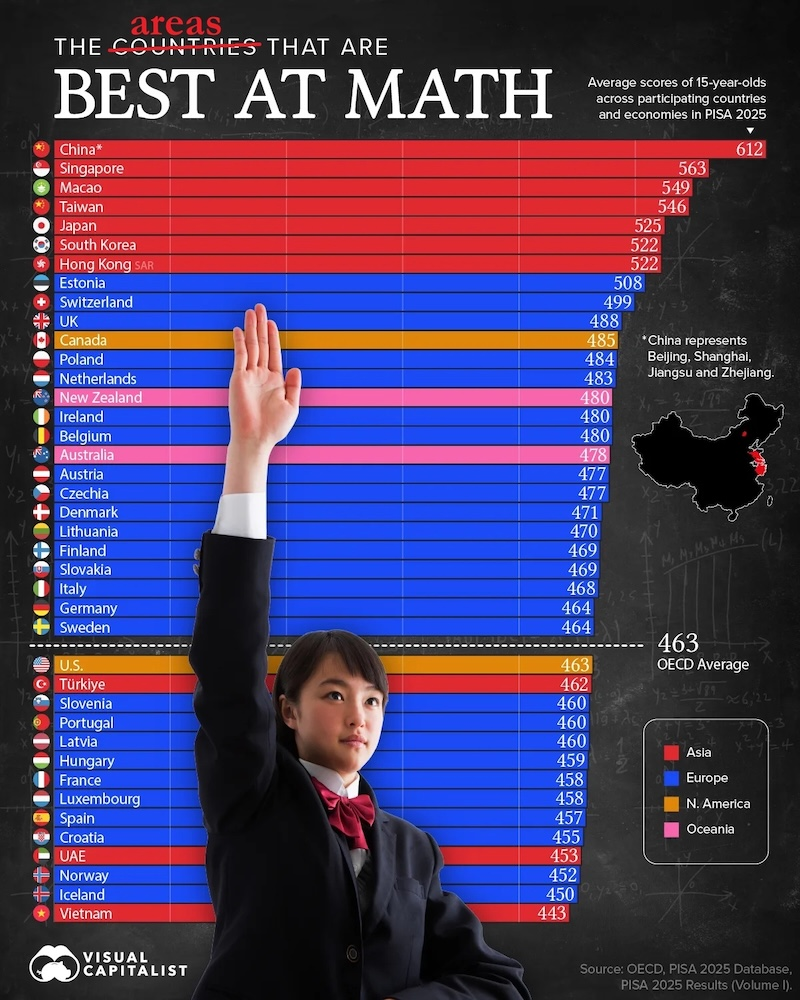
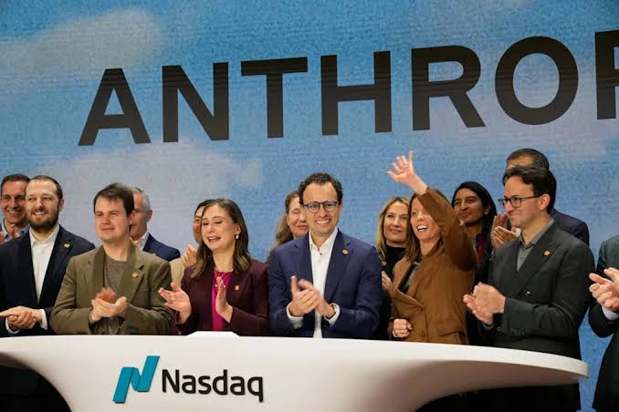
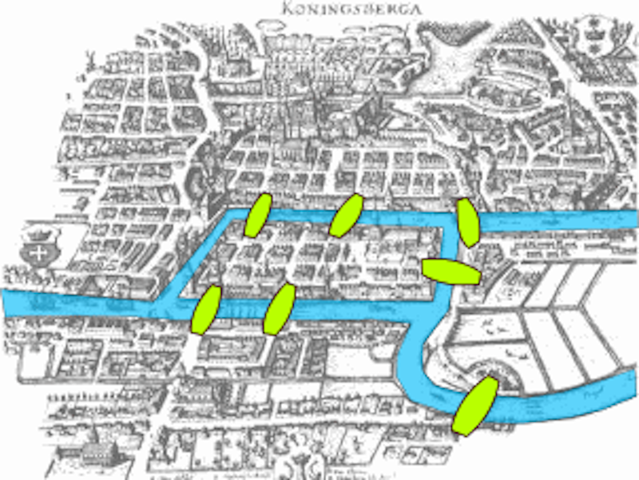
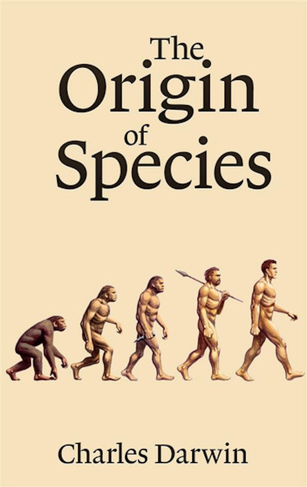

## Editor's Words

I do all my coding through voice dictation now, by speaking into a DJI transmitter microphone, with a Google Gemma 4 model running on a Mac Mini handling the AI enhancement. The difference is night and day. 

Curating and editing the stories for the Sunday Blender used to require a lot of typing. Not anymore. I talked to Claude for two hours, giving my editorial notes to its drafts in multiple iterations to sharpen the narratives, and voila, the newsletter is ready.

It does not necessarily cut down the hours, but it surely allows me to do probably 5x more iterations in the same hours than what was possible in the old-fashioned typing mode. I’d like to think the stories have a sharper edge, more focus, and a stronger punch line, vs. those issues in 2025. 

Do you feel the same?

## Tech

AI that does office work by itself is shaking up the business world. In January 2026, the American company **Anthropic** released **Claude Cowork**, which runs on a computer and finishes tasks on its own, such as sorting files, analyzing data and writing reports. Investors worried that tools like it could replace software people pay for, and **Microsoft**, whose **Office** programs have been the standard at work for more than 30 years, lost about `$220 billion` in stock market value in one week. Microsoft answered in March with **Copilot Cowork**, which is built with Anthropic's technology and works inside Microsoft 365. China's tech giants followed. **Tencent**, the company behind **WeChat**, launched **WorkBuddy** in March. By early November it had more than `10 million` users a day, and Tencent says it is on pace to bring in more than `$500 million` a year, double what its video-call app Tencent Meeting makes. **ByteDance**, the owner of **TikTok**, joined in August with **Doubao Work**, which connects to **Feishu**, its workplace chat app, and now has more than `8 million` daily users. **Alibaba** and **Baidu** have office agents of their own. Chinese AI company **DeepSeek** released **DeepSeek Harness**, a free toolkit for programmers to build their own AI agent in August. 

**Steam**, **Valve**’s online store for PC games, is having its busiest year ever, and much of the growth comes from games made with artificial intelligence. More than `27,000` games have been released on Steam this year, compared with about `21,000` in 2025. In October, almost half of new releases carried a label saying AI was used to make some of the content, most often the artwork. Valve has required these labels since January 2024. The rise showed up at October’s **Steam Next Fest**, a week when players can try free demos of upcoming games, which featured more than `7,000` demos, more than double the roughly `3,000` at the same event last year. The more popular a game is, the less likely it is to use AI: only `14%` of this year’s games with at least `1,000` player reviews carry the AI label, compared with `47%` of those with fewer than 10 reviews.

**SpaceX** caught the top half of its **Starship** rocket with the arms of its launch tower on November 14, the first time a Starship has come back from orbit and been caught. The ship launched from Starbase, Texas, the day before, circled Earth 14 times and released 26 **Starlink** internet satellites. About 22.5 hours after liftoff, it dropped back through the atmosphere at about `27,000` kilometers per hour, slowed down and lowered itself into the tower's giant mechanical arms, nicknamed "chopsticks." The Super Heavy booster, the bottom half, was supposed to be caught minutes after launch, but it ran low on fuel and was destroyed over the Gulf of Mexico. SpaceX has caught boosters on three earlier flights, but never both halves of the same rocket.

## Global

**The United States** has lost its status as a country that has eliminated **measles**, the Pan American Health Organization announced on November 17. The US had held it since 2000. A country loses the status when the same version of the virus keeps spreading inside it for 12 months or more. Measles passes through the air when an infected person coughs or sneezes, and it can stay in a room for up to two hours after they leave. Up to nine in 10 unprotected people near an infected person will catch it. Since January 2025, US states have reported `5,412` cases. The first big outbreak, in West **Texas**, sickened about 800 people, and one in **South Carolina** reached 997 cases, the largest since 2000. This year, **Pennsylvania** has had the most cases, nearly 1,500. The **UK**, **Spain** and **Austria** lost their status in January, while **South Korea** has just kept its status for a 13th straight year.

Fifteen-year-olds in four parts of China, Beijing, Shanghai, Jiangsu and Zhejiang, posted the highest math score in **PISA 2025**, an international school test, averaging `612` points. More than `760,000` students in `91` countries and economies took the test, run by the **OECD**, an international organization of mostly developed countries, and the results came out in September. **Singapore** came second with `563`, and the top seven places all went to education systems in East Asia. **Estonia** led Europe with `508`, and **Canada** led North America with `485`. Those four regions were the only part of mainland China to take part, so the score is not one for the whole country. **The United States** placed `27th` with `463`, exactly the average across OECD member countries. That average is the lowest since the test began in 2000, and `22` points below where it was in 2015.

## Economy & Finance

Shares of **Anthropic**, the company that makes the **Claude** chatbot, began trading on the **Nasdaq** stock exchange on November 19. A company’s first sale of shares to the public is called an initial public offering, or IPO, and it lets ordinary investors own a small piece of the business. Anthropic raised `$81.3 billion`, the most any company has ever raised this way, beating the `$75 billion` **SpaceX** raised in June. By the end of the first day, buyers had pushed the company’s total value to about `$1.76 trillion`. Anthropic earns its money from Claude, and most of it comes from businesses, which use it for jobs such as writing computer code; eight of the ten largest companies in the United States are customers. In the first nine months of this year, Anthropic took in `$33.2 billion`, about `13` times as much as in the same months of 2025.

## Nature & Environment

Chinese **white dolphins** have been spotted again in Tong’an Bay, in **Xiamen**, China, after more than ten years away, according to a local official quoted by China Daily. The bay was once crowded with oyster farms that blocked the flow of seawater. Since 2006, Xiamen has cleared those farms, opened gaps in sea walls so the tides can wash through, and replanted mangrove forests. About `80` of the dolphins live in Xiamen’s waters. Despite the name, adults are often pink, a color that comes from blood vessels close to the surface that help them shed heat. Like all dolphins and whales, they descend from four-legged land mammals that lived about `50 million` years ago, and their closest living relative outside the whale family is the hippopotamus. Their cousins, bottlenose dolphins, are among the few animals known to recognize themselves in a mirror, along with humans, great apes, elephants, and magpies.

## Science

Scientists in Germany and Israel have found a new pulsar hidden in 15 years of data from **NASA**’s **Fermi Gamma-ray Space Telescope**, which anyone can download free. A pulsar is the super-dense leftover of an exploded star, spinning so fast that its beams of radiation sweep past Earth like a lighthouse’s. This one, named PSR J1622−7204, spins `261` times every second. Pulsars are hard to find in Fermi’s data because the telescope catches only a few of their gamma rays, mixed in with noise from the rest of the universe. The team turned the search into a geometry puzzle, using a type of math that cryptographers developed while trying to break secret codes. Their search took the equivalent of about `10` hours on an ordinary computer processor. The previous best method had used about `600` years of processor time on the same problem and still missed it.

## Math

The Prussian city of **Königsberg**, now **Kaliningrad** in Russia, sat on both banks of the Pregel River and two islands, joined by seven bridges. Its people are said to have tried, on Sunday walks, to cross every bridge exactly once. Nobody managed it, and in 1736 the Swiss mathematician **Leonhard Euler** proved that nobody could. Every time you walk onto a piece of land, you must also leave it, so every piece of land except where you start and finish needs an even number of bridges. In Königsberg, all four pieces of land had an odd number: one had five bridges and the others three each. Euler’s method, which looked only at what connects to what, is considered the start of **graph theory**. Some bridges were later destroyed or replaced, and today’s five can be crossed once each if you start on one island and finish on the other.

## Lifestyle, Entertainment & Culture

**Grand Theft Auto VI** went on sale on November 19 and brought in an estimated `$3.79 billion` on its first day, according to its publisher, Take-Two Interactive. The company says that is the biggest launch ever for any kind of entertainment, including films. Much of that money arrived before anyone could play: fans had already bought `32.5 million` copies through pre-orders, a record for any video game. The previous launch record belonged to Grand Theft Auto V, which made about `$815 million` on its first day in 2013. The new game arrived 13 years later and is available on PlayStation and Xbox. It scored `99` out of 100 on **Metacritic**, a site that averages critics’ reviews. The only other game with that score is **The Legend of Zelda: Ocarina of Time**, released for the **Nintendo 64** in 1998, which held the top spot alone for nearly 28 years.

**Robert Pattinson** will be the next **James Bond**, the studio behind the films announced on November 16. The 40-year-old British actor first became known as **Cedric Diggory** in **Harry Potter and the Goblet of Fire** in 2005, then played the vampire Edward Cullen in the **Twilight** films. He is also the current Batman, and he won the Bond role after a screen test in London in late October, during a break from filming The Batman: Part II. That fame sets him apart, since earlier Bonds usually arrived far less well known, and one of them was a model with almost no acting experience. Pattinson’s age is right in the middle of the range: the six actors before him started the job between 30 and 45. At about `1.83 meters`, he is roughly 5 centimeters taller than **Daniel Craig**, the most recent Bond.

**IShowSpeed** was named **Streamer of the Year** at the **Streamer Awards** in Los Angeles on November 12, becoming the first person to win the top prize three years in a row. The 21-year-old American, whose real name is Darren Watkins Jr., also won Best IRL Streamer, an award for creators who film themselves out in the real world, and Best Streamed Series for his World Cup Tour. He gave his acceptance speech entirely in Indonesian. Winners are picked mostly by fans, with 70% of the result coming from a public vote and 30% from a panel of judges. He is known for long live streams filmed on trips around the world. In March and April 2025, he spent two weeks broadcasting from eight Chinese cities, including **Shanghai**, **Beijing**, **Chongqing** and **Shenzhen**. He did a backflip on the Great Wall and tried local food. Each stream drew millions of views, and he gained more than a million new subscribers during the trip. **China Daily**, a Chinese newspaper, later put it on its list of the top 10 cultural events of 2025. Five days after the Streamer Awards, he won Streamer of the Year again, this time at the **Esports Awards** in Miami.

## Sports

**Nikola Jokic** scored 24 of his 26 points after halftime as the **Denver Nuggets** beat the **Houston Rockets** `133-124` in an NBA Cup game on November 20. Houston had beaten Denver 110-100 just 11 days earlier. This time the lead changed hands `32` times, and neither team was ahead by more than five points until two minutes remained. Jokic took over in the third quarter, scoring `18` points in that quarter alone, and finished with 11 assists and 7 rebounds. Houston’s Alperen Sengun had a triple-double of 28 points, 11 rebounds and 10 assists. Denver pulled away with a 17-4 run late in the fourth quarter. Jokic, a three-time winner of the league’s **Most Valuable Player** award, has now scored at least 24 points in five straight games.

**Erling Haaland** scored twice, including a penalty six minutes into stoppage time, as **Norway** came back from 2-0 down to beat **Denmark** `3-2` in Copenhagen on November 17 and reach the quarterfinals of the **UEFA Nations League**. Denmark took control early, with Rasmus Højlund scoring in the 11th minute and Pierre-Emile Højbjerg adding a second three minutes later. Haaland pulled one back before halftime, finishing from close range after a pass from Martin Ødegaard. Norway dominated the second half, taking 11 shots to Denmark’s three, and Ødegaard tied the game in the 83rd minute. The winner came after Denmark defender Joachim Andersen was penalized for handling the ball in the penalty area, and Haaland scored the penalty with his left foot. Haaland, 26, now has `68` goals in `61` games for his country, more goals than games, and he has been Norway’s all-time top scorer since 2024, when he broke a record that had stood since `1937`.

**Bilibili Gaming (BLG)**, a team from China, won the **League of Legends World Championship** on November 14, beating South Korea's **Gen.G** `3-1` in the final at the Barclays Center in New York. League of Legends is a computer game where two teams of five battle to destroy each other's base. Bilibili Gaming lost the first game of the final, then won the next three. **Knight**, who plays in the middle lane, was named the final's most valuable player. It is the team's first world title, two years after it lost the 2024 final to South Korea's T1. It beat all four South Korean teams it faced. In the semifinal, it knocked out T1, the three-time defending champions, led by **Faker**, who has won six world titles and is widely seen as the game's greatest player. Korean teams had won the four previous championships, and no Chinese team had won since 2021.

## This Day in History

On November 22, 1859, the London publisher John Murray offered booksellers a new book by **Charles Darwin** called **On the Origin of Species**. The book argued that living things change slowly over many generations, because those best suited to their surroundings are more likely to survive and pass on their traits. Darwin called this natural selection. Part of the idea came from his five-year voyage on a ship called the Beagle. Mockingbirds he collected on the **Galápagos Islands** turned out to be three separate species, each living on only one island. The word “evolution” does not appear in the first edition, and the phrase “survival of the fittest” was borrowed from another writer, Herbert Spencer, and only added in 1869. Today scientists regard the book as the foundation of the study of evolution, and Darwin is among the most translated science writers in history.

## Art of the Week

British painter **Paul Evans** has spent about 50 years painting the English countryside, and more than 500 of his pictures have been printed on greeting cards, calendars and art prints. Growing up in Sussex, he learned to recognize birds by their songs, and at eight he was given a painting-by-numbers set for Christmas and started drawing birds. He studied illustration and printmaking at art college in Eastbourne and has earned his living from painting ever since. Today he lives near the village of Lavenham in Suffolk, in eastern England, and paints only a few places, going back to them in every season to capture changes in light and weather. One of his paintings, Along the Lane to Hawkedon, is a square picture 38 centimeters wide, made with ink and acrylic paint. He paints outdoors even in winter, wearing a jacket he heats up before leaving the house, and says a snowy landscape holds far more color than most people realize. He once waited about 15 years for snow to settle on the beach at Aldeburgh, a Suffolk seaside town, then spent a long morning painting the boats there before it melted.

## Funny

> No one will bring up politics, but be prepared to discuss who should’ve been the next James Bond for hours.”

*Cartoon by Ali Solomon on the New Yorker*

---

## Previous Issues

---

November 15, 2026, **[Don’t Stop Believin'](https://weekly.sundayblender.com/p/dont-stop-believin/)**

November 08, 2026, **[The Revenge of the King](https://weekly.sundayblender.com/p/the-revenge-of-the-king/)**

November 01, 2026, **[Free As A Bird](https://weekly.sundayblender.com/p/free-as-a-bird/)**

---

Thanks for reading! If you enjoy this newsletter, please share it with friends who might also find it interesting and refreshing, if not for themselves, at least for their kids.

